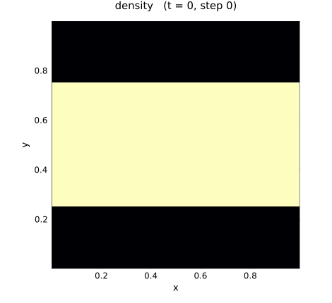
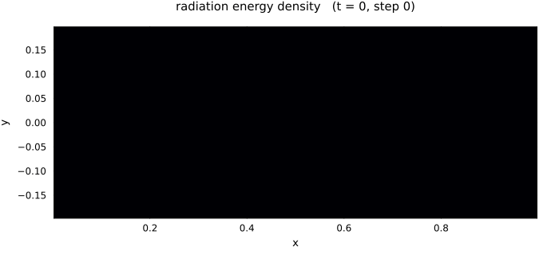
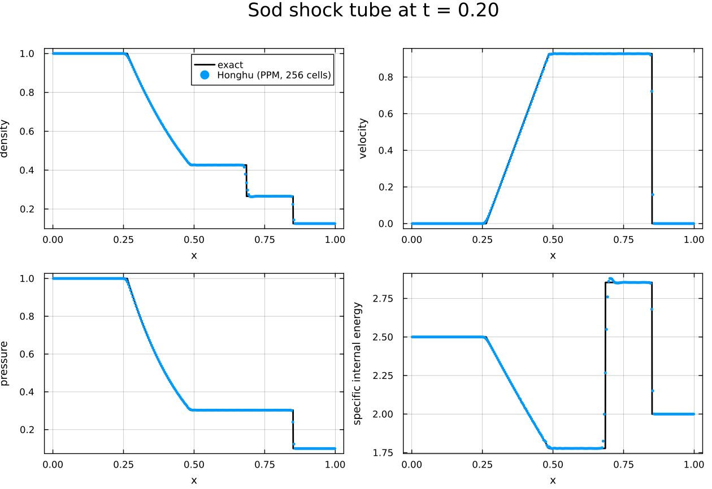
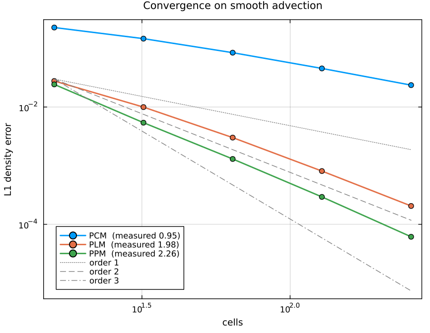
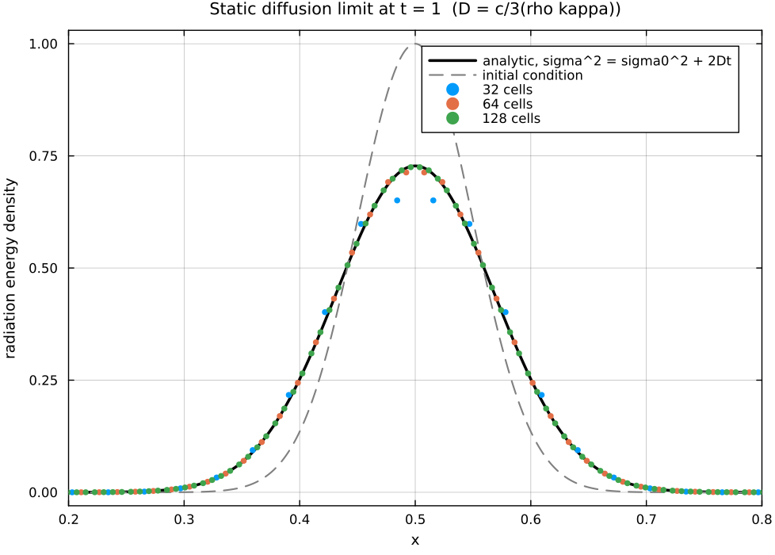
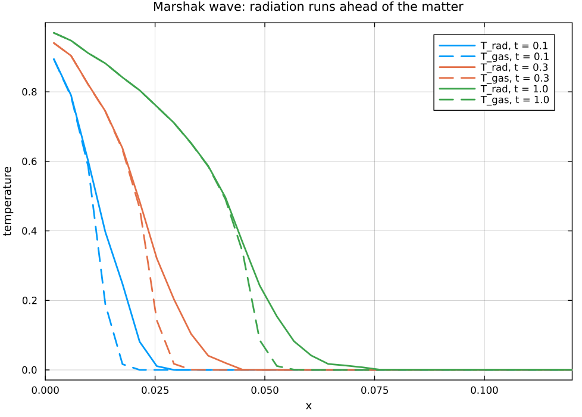
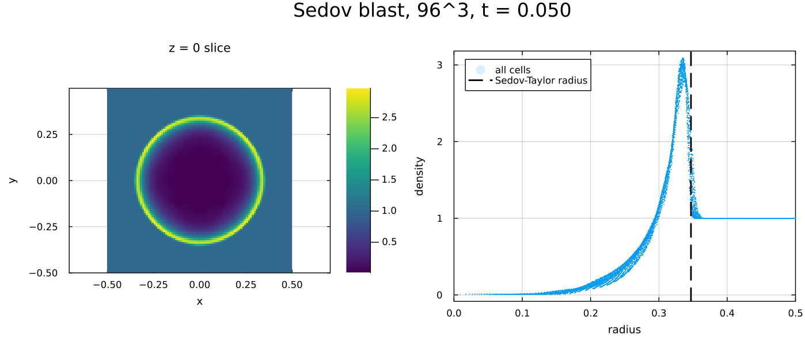
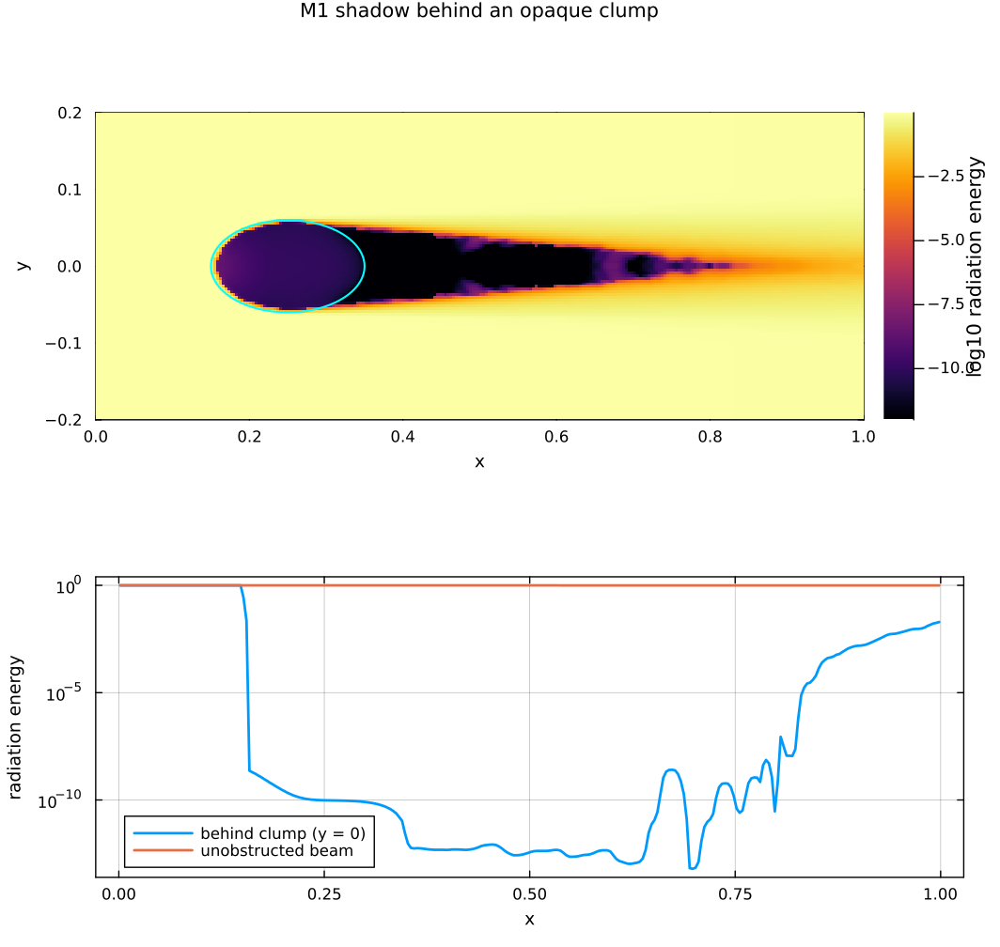
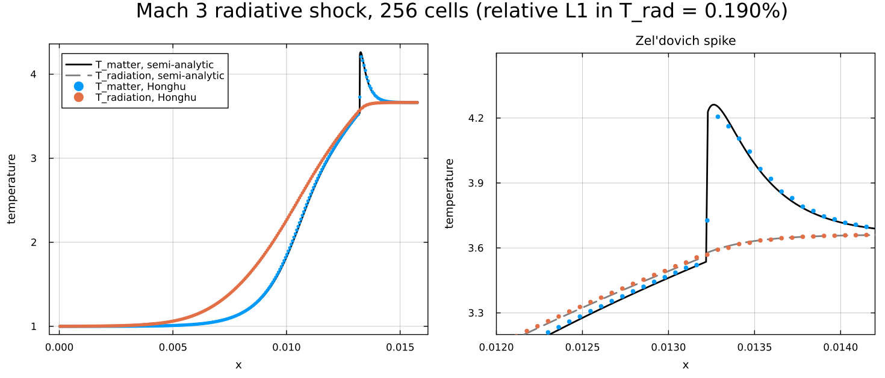

# Hydro3D.jl

A three-dimensional radiation-hydrodynamics code in pure Julia. Solving needs nothing outside the standard library; plotting is a weak dependency that activates only if you load Plots.

Hydro3D solves the Euler equations coupled to the grey two-moment (M1) radiation transport equations on a uniform Cartesian grid. It is a rewrite of [Hydro.jl](../Hydro.jl) following the algorithms of [Quokka](https://github.com/quokka-astro/quokka) (Wibking & Krumholz 2022; He, Wibking & Krumholz 2024).

| Kelvin-Helmholtz instability | M1 radiation shadow |
|:---:|:---:|
|  |  |
| $256^2$, PPM + SSPRK3 | a beam striking an opaque clump; colour is $\log_{10}E_r$ over ten decades |

## What it solves

**Hydrodynamics.** The compressible Euler equations,

$$\partial_t \rho + \nabla\cdot(\rho\mathbf{v}) = 0, \qquad \partial_t (\rho\mathbf{v}) + \nabla\cdot(\rho\mathbf{v}\mathbf{v} + P\mathbb{I}) = \mathbf{f}_\mathrm{rad}, \qquad \partial_t E + \nabla\cdot[(E+P)\mathbf{v}] = \dot{e}_\mathrm{rad},$$

with an ideal-gas equation of state.

**Radiation.** The first two angular moments of the radiative transfer equation, closed with the Levermore (1984) M1 closure,

$$\partial_t E_r + \frac{\hat{c}}{c}\nabla\cdot\mathbf{F}_r = S, \qquad \partial_t \mathbf{F}_r + \hat{c}\,c\,\nabla\cdot(\mathbb{T}E_r) = \mathbf{S}_F,$$

where $\mathbb{T}(\mathbf{f})$ is the Eddington tensor built from the reduced flux $\mathbf{f} = \mathbf{F}_r/(cE_r)$. M1 interpolates between the correct free-streaming limit ($\mathbb{T}\to\hat{n}\hat{n}$, radiation travels in straight lines and casts shadows) and the diffusion limit ($\mathbb{T}\to\mathbb{I}/3$), which is what distinguishes it from flux-limited diffusion.

## Numerical method

Space and time are separated by the **method of lines**: a spatial operator $L(U) = -(F_{i+1/2}-F_{i-1/2})/\Delta x$ is assembled once per stage, and the stages are pure ODE updates.

| Component | Choice |
|:---|:---|
| Reconstruction | piecewise constant (`PCM`), piecewise linear (`PLM`, four limiters), piecewise parabolic (`PPM`) |
| Hydro Riemann solver | `HLLC` (default) with Batten wave speeds, Rider's nonlinear correction, and the Minoshima & Miyoshi (2021) carbuncle cure and low-dissipation pressure; or `LLF` |
| Radiation Riemann solver | `HLL` on the M1 system with frozen-Eddington-tensor wave speeds (Skinner & Ostriker 2013; Balsara 1999) |
| Hydro time integration | SSP Runge-Kutta, first to third order (`ForwardEuler`, `SSPRK2`, `SSPRK3`) |
| Radiation time integration | **IMEX PD-ARS**: transport explicit, stiff matter coupling implicit; second order and asymptotic-preserving |
| Matter-radiation coupling | 2×2 Newton-Raphson per cell in $(E_\mathrm{int}, R)$, with an analytic flux/momentum update and a lagged outer iteration for the $\mathbf{v}\cdot\mathbf{F}$ work term |

Radiation subcycles inside each hydro step at the reduced speed of light $\hat{c}$. A degenerate direction (`n[d] == 1`) carries no ghost cells and is skipped entirely, so 1D and 2D problems cost what they should.

## Install and run

Requires Julia 1.9 or newer. The solver depends only on `Printf` and `Dates`, both Julia standard libraries, so there is nothing to install. `Plots` is optional: load it and the plotting methods appear (see [Plotting](#plotting)); leave it out and the ~100-package plotting stack never enters the picture, which matters on a compute node.

```julia
using Pkg; Pkg.develop(path = "hydro3d.jl")
using Hydro3D
```

A shock tube in five lines:

```julia
sim = Simulation(n = (256, 1, 1), eos = IdealGas(gamma = 1.4),
                 boundaries = Boundaries(Outflow()))
set_initial_conditions!(sim) do x, y, z
    x < 0.5 ? (rho = 1.0, p = 1.0) : (rho = 0.125, p = 0.1)
end
run!(sim, tmax = 0.2)
```

A 3D radiation-hydrodynamics run, writing snapshots for ParaView:

```julia
rad = RadiationPhysics(c = 2.998e10, chat = 2.998e8, a_rad = 7.5657e-15,
                       opacity = ConstantOpacity(0.4))
sim = Simulation(n = (128, 128, 128), xhi = (1e15, 1e15, 1e15),
                 eos = IdealGas(gamma = 5/3, cv = cv_from_mu(0.6, 5/3)),
                 radiation = rad, boundaries = Boundaries(Outflow()))
set_initial_conditions!(sim) do x, y, z
    (rho = 1e-20, T = 10.0, Erad = 7.5657e-15 * 10.0^4)
end
run!(sim, tmax = 1e5, outdir = "out", dtout = 1e4)
```

Run with threads: `julia -t auto script.jl`.

## Built-in problems

Each returns `(sim, tmax)`, ready to `run!`:

```julia
sim, tmax = Hydro3D.Problems.kelvin_helmholtz(n = 512)
run!(sim; tmax, outdir = "kh", dtout = 0.02)
```

| Problem | Tests |
|:---|:---|
| `sod_shock_tube` | shocks, contacts, rarefactions against `sod_exact` |
| `smooth_advection` | order of accuracy of the reconstruction |
| `kelvin_helmholtz` | 2D shear instability, exact conservation |
| `sedov_blast` | 3D strong explosion, spherical symmetry on a Cartesian grid |
| `radiation_streaming` | free-streaming limit: the front must move at exactly $\hat{c}$ |
| `radiation_diffusion` | static diffusion limit against an analytic Gaussian |
| `matter_coupling` | stiff energy exchange, equilibrium and exact energy conservation |
| `marshak_wave` | non-equilibrium radiation-driven heat wave |
| `radhydro_shock` | Mach 3 radiative shock against the Lowrie & Edwards semi-analytic solution |
| `radiation_shadow` | M1 casting a sharp shadow behind an opaque clump |

See `examples/` for scripts that run and post-process these. **Every example writes a figure** whenever Plots is available — that is the default, not a flag — alongside its VTK or text output:

```bash
julia --project=. -t auto examples/sod_1d.jl              # -> sod.png, sod.txt, sod_exact.txt
julia --project=. -t auto examples/sod_1d.jl 1024         # positional arguments still work
julia --project=. -t auto examples/sod_1d.jl --no-plot    # data only, for batch jobs
julia --project=. -t auto examples/sod_1d.jl --outdir=run # send everything somewhere else
```

Without Plots installed the examples still run and still write their data, and say in one line how to get the figures.

## Comparing schemes

The question this code exists to answer is *does variant B beat variant A, and does the answer survive refinement*. `compare` runs a problem once per (scheme, resolution), scores each run with the problem's own metrics, prints a table and writes it to disk.

```julia
using Hydro3D
const P = Hydro3D.Problems

compare(P.sod_shock_tube, :riemann, (HLLC(), LLF()); sizes = (64, 128, 256, 512))
```

```
  variant        size       cells       steps      wall_s  l1_density
  HLLC             64          64          69    0.002033     0.01004
  HLLC            128         128         139    0.001882    0.004942
  ...
  (zero for every run: floors, newton_mean, newton_max, newton_failures)
  convergence rate, -dlog(metric)/dlog(size):
  variant  l1_density
  HLLC           0.95
  LLF            0.97
```

Any keyword the problem forwards to `Simulation` can be swept — `:reconstruction`, `:integrator`, `:closure`, `:cfl` — and the value labels its own rows, so the scheme's name is written once rather than three times. When a variant needs more than one keyword, spell them out:

```julia
compare(P.radhydro_shock, (P1 = (closure = EddingtonClosure(),),
                           M1 = (closure = LevermoreClosure(),)); sizes = (64, 128, 256))
```

Underneath both of those, a variant is a **builder**: a function of resolution returning `(sim, tmax)`, which is the contract the problem factories already satisfy. Hand builders in directly and a variant can differ in anything at all — a different initial condition, a different geometry, a global flag — not only in keywords the harness knows how to pass:

```julia
compare(["flat"  => nx -> setup(nx, amplitude = 0.1),
         "steep" => nx -> setup(nx, amplitude = 0.9)];
        sizes = (64, 128, 256), metrics = default_metrics(P.smooth_advection))
```

Because every built-in problem takes `n` for resolution, nothing has to inspect a factory to discover what it calls it. (`nx` still works everywhere as a human-facing alias.)

You can also hand over simulations you have already built, however they differ:

```julia
a, _ = P.sod_shock_tube(n = 256, riemann = HLLC())
b, _ = P.sod_shock_tube(n = 256, riemann = LLF())
compare("HLLC" => a, "LLF" => b; tmax = 0.2, metrics = default_metrics(P.sod_shock_tube))
```

There is no sweep in that form — every configuration field of `Simulation` is `const`, so an instance pins its own grid — and therefore no convergence rate. `plotcompare` draws such a table as a bar chart rather than putting a single point per series on a log axis. `tmax` is required, since a simulation carries no stopping time of its own, and the simulations are run in place, so they come back finished and ready to plot.

Every run also records `steps`, `wall_s`, `floors` and the Newton statistics, so a variant that is more accurate *because* it took ten times as long, or that only converged with help from the positivity floors, is visible rather than flattering. The first run of each variant is a discarded warm-up, so `wall_s` measures the solver rather than Julia's compiler.

The table is the durable artefact; `plotcompare` draws from it, so a figure is reproducible from stored numbers months later, with the git hash that produced them stamped on:

```julia
using Plots
plotcompare("sod_shock_tube_riemann_compare.txt",
            "smooth_advection_riemann_compare.txt")   # the same schemes, two problems
```

Problems with an exact solution carry their own metrics (`default_metrics`, one method per problem in `src/problems/metrics.jl`). The rest need `metrics = (; name = sim -> ...)`; `compare` refuses to invent a number rather than printing an authoritative-looking one.

`examples/compare_schemes.jl` is the worked version — HLLC against LLF on a shock tube *and* on smooth flow, because one problem gives you a ranking and two tell you whether the ranking means anything.

## Verification

Every figure below is regenerated by `julia --project=. -t auto docs/make_figures.jl`, or by running the test suite with `--figures`. Each compares the code against something independent: an exact Riemann solution, an analytic diffusion solution, a measured convergence slope, or a similarity solution.

```bash
julia --project=. -t 4 test/runtests.jl             # 644 tests, ~20 s
julia --project=. -t auto test/runtests.jl --figures # ... and redraw the figures below
```

| | |
|:---:|:---:|
|  |  |
| **Sod shock tube** against the exact Riemann solution at $t = 0.2$, 256 cells. | **Order of accuracy** on smooth advection. PCM, PLM and PPM sit on their expected slopes. |
|  |  |
| **Static diffusion limit** against the analytic Gaussian $\sigma^2 = \sigma_0^2 + 2Dt$. The answer is independent of how many mean free paths a cell spans, which is the asymptotic-preserving property. | **Marshak wave**: radiation runs ahead of the matter, so $T_{\rm rad}$ and $T_{\rm gas}$ separate at the front and merge behind it. |
|  |  |
| **Sedov blast**, $96^3$. Every cell in the box collapses onto one radial profile, and the shock sits on the Sedov-Taylor radius. | **M1 shadow**. The clump removes the beam over ten decades; a diffusion-based scheme would let radiation leak around it. |



**Mach 3 radiative shock** (Lowrie & Edwards 2008), against the semi-analytic solution. This is the most demanding one-dimensional problem in the suite: an optically thick, strongly coupled shock with a radiative precursor ahead of the front and, just behind it, a *Zel'dovich spike* where the matter temperature overshoots its own downstream value ($4.26$ against $3.66$). The spike appears only if the velocity-dependent coupling terms, the implicit solve and the shock capturing are all correct at once. Relative $L_1$ error in $T_\mathrm{rad}$ is $0.19\%$ at 256 cells, against the $1\%$ Quokka asks for.

The test suite (`julia --project=. -t 4 test/runtests.jl`, 454 tests, ~12 s) checks, among other things:

- **Order of accuracy** on smooth advection: PCM 1, PLM 2, PPM 2.3. PPM stops short of 3 because the Colella-Woodward monotonicity constraint drops to a limited line at the two extrema of the sine wave; this matches the same limiter in Athena++ and Quokka.
- **Toro's five shock tubes**, including the "123" near-vacuum problem and both strong blasts, all staying positive with no help from the floors.
- **Conservation**: mass, momentum and total energy to $10^{-14}$ relative on periodic boundaries.
- **Directional isotropy**: the same problem run along $x$, $y$ and $z$ gives bitwise-comparable profiles.
- **Free streaming**: the radiation front arrives at $\hat{c}t$ to 2%, with $|\mathbf{F}| \le cE$ everywhere.
- **Static diffusion**: relative $L_1$ error against the analytic Gaussian of 0.6%, 0.13%, 0.06% at 64, 128, 256 cells — the scheme is asymptotic-preserving, so the answer does not depend on how many mean free paths a cell spans.
- **Stiff coupling**: a single step $10^{5}$ times longer than the coupling time still lands on radiative equilibrium, conserving $E_\mathrm{int} + (c/\hat{c})E_r$ to $10^{-13}$.
- **Radiative shock**: relative $L_1$ error in $T_\mathrm{rad}$ of $0.19\%$ at 256 cells against the semi-analytic solution, with the Zel'dovich spike converging to $4.21$ from an exact $4.26$ and no positivity floors triggered.
- **Radiation force**: momentum transfer matches $\Delta p = (\rho\kappa/c)F_0(1-e^{-\hat{c}\rho\kappa t})/(\hat{c}\rho\kappa)$ to 1%, converging at second order.

## Performance

`julia --project=. -t 8 test/benchmarks.jl` on Apple silicon, Julia 1.12, `Float64`:

| | $32^3$ | $64^3$ |
|:---|---:|---:|
| Hydrodynamics | 9.8 Mcell-updates/s | 13.1 Mcell-updates/s |
| Radiation-hydrodynamics | 5.3 Mcell-updates/s | 6.9 Mcell-updates/s |

Per-kernel breakdown at $64^3$, one sweep or one pass each:

| kernel | ns/cell |
|:---|---:|
| `cons2prim` | 0.26 |
| reconstruct, PLM | 1.39 |
| reconstruct, PPM | 2.71 |
| HLLC sweep | 2.78 |
| HLL radiation sweep | 1.98 |
| implicit matter coupling | 21.9 |

The implicit coupling dominates a radiation step, as it should: it is a Newton solve per cell. Allocation per step is flat in the grid size (138 KiB for hydrodynamics, 250 KiB with radiation, all of it threading overhead), and `test/test_performance.jl` asserts that every hot kernel stays below 8 bytes per cell — a regression test for a boxing bug that once cost 12 kB per cell.

**Memory.** Buffers scale as roughly `72 * ncells * 8` bytes when radiation is enabled, `35 * ncells * 8` without, where `ncells` includes ghost cells. A $128^3$ radiation-hydrodynamics run needs about 1.4 GB; pure hydrodynamics at $128^3$ needs about 0.7 GB.

## Output

- `write_vtk(sim, path)` — a self-contained `.vti` image-data file with raw appended binary, written without any dependency. ParaView, VisIt and yt open it directly, and a numbered series (`data_00000.vti`, `data_00001.vti`, …) is read as a time series.
- `write_line(sim, path; dir, at)` — a plain-text table along one axis, for quick plotting of shock tubes and Marshak waves.
- `save_checkpoint` / `load_checkpoint!` — raw binary restart files.

`run!(sim; tmax, outdir, dtout)` writes VTK snapshots on a fixed cadence and trims the step so that it lands exactly on the output times.

## Plotting

`field(sim, name)` extracts any named quantity as a plain `(nx, ny, nz)` array and needs no packages:

```julia
rho, label = field(sim, :density)
available_fields(sim)   # :density, :vx, :speed, :pressure, :temperature, :mach, :Erad, :Trad, ...
```

Loading Plots activates a package extension that adds the plotting methods. They pick the representation from the dimensionality: a line in 1D, a heat map in 2D, a mid-plane slice in 3D.

```julia
using Plots, Hydro3D

sim, tmax = Hydro3D.Problems.kelvin_helmholtz(n = 256)
run!(sim; tmax)

plot(sim)                                  # a recipe, so plot/plot! work directly
plotstate(sim, var = :Erad, logscale = true)
plotpanels(sim)                            # density, speed, pressure, temperature (+ radiation)
animate_run(sim; tmax = 4.0, var = :density, filename = "kh.gif")
```

Call any of them without Plots loaded and you get an error telling you to load it, not a `MethodError`.

`docs/make_figures.jl` and `docs/make_animations.jl` regenerate everything shown above.

## Layout

```
hydro3d.jl/
  Project.toml   dependencies: Printf, Dates (both stdlibs); Plots is a weak dependency
  README.md      this file
  CLAUDE.md      invariants, performance traps, and a per-file guide to src/
  logs.md        development log: what was asked for, what was built, why
  src/           the package -- 28 files, one concern each
    riemann/     one Riemann solver per file, mirroring Quokka's headers
    problems/    built-in problems, exact solutions, per-problem metrics
  ext/           plotting methods, loaded only when Plots is present
  test/          688 tests in eleven files, plus benchmarks.jl
  docs/          make_figures.jl, make_animations.jl, and the generated figures/
  examples/      sod_1d, kelvin_helmholtz_2d, sedov_3d, compare_schemes,
                 marshak_wave, radiation_shadow, radiating_blast_3d
```

The include order in `src/Hydro3D.jl` is significant, because later files use types defined earlier. `CLAUDE.md` has the file-by-file table and the invariants each layer relies on.

## Extending

The code is built around small, dispatch-based interfaces. To add your own piece of physics, define a type and a few methods:

```julia
struct KramersOpacity <: Hydro3D.AbstractOpacity end
Hydro3D.planck_opacity(::KramersOpacity, rho, T) = 4e25 * rho * T^-3.5
Hydro3D.flux_mean_opacity(op::KramersOpacity, rho, T) = Hydro3D.planck_opacity(op, rho, T)
Hydro3D.energy_mean_opacity(op::KramersOpacity, rho, T) = Hydro3D.planck_opacity(op, rho, T)
```

The same pattern works for `AbstractEOS`, `AbstractOpacity`, `AbstractLimiter`, `AbstractReconstruction`, `AbstractIntegrator`, `AbstractRiemannSolver`, `AbstractClosure` and `BoundaryCondition`. `test/test_extensions.jl` defines a toy subtype of every one of them and runs a simulation with it, so it doubles as copy-paste documentation of exactly which methods each interface needs.

## Source terms

Two hooks, for two different jobs.

`source = f(x, y, z, t)` returns a **radiation** energy source density and is applied inside the implicit matter–radiation coupling, where a stiff emission term belongs. It is the right place for a star's luminosity spread over a cell.

`strang_sources = f(sim, t, dt, order)` is the general operator-split hook, applied at $\Delta t/2$ before the advance and $\Delta t/2$ after it, mutating `sim.U` and `sim.R` in place. This is Quokka's `addStrangSplitSources`, called from the same two places in the driver, and it is where gravity, external driving and cooling go. The two half-steps make it second order: the pair is the trapezoid rule in time, so a source with a linear time dependence is integrated exactly.

```julia
function gravity!(sim, t, dt, order)
    g = sim.grid
    for k in g.lo[3]:g.hi[3], j in g.lo[2]:g.hi[2], i in g.lo[1]:g.hi[1]
        rho = sim.U[Hydro3D.IRHO, i, j, k]
        dp = -9.8 * rho * dt
        sim.U[Hydro3D.IEGAS, i, j, k] += dp * (sim.U[Hydro3D.IMY, i, j, k] + dp / 2) / rho
        sim.U[Hydro3D.IMY, i, j, k] += dp
    end
end

Simulation(n = (64, 64, 1), strang_sources = gravity!)
```

Nothing is built on this hook — no gravity, no cooling, no driving are shipped. It exists so that adding one does not mean editing `step!`. `order` is `SourceForward` or `SourceReverse`, and matters only if you apply several non-commuting terms in sequence.

## Units

Hydro3D is unit-agnostic: `c`, `a_rad`, `cv` and the opacities are all supplied by you. Use `Hydro3D.CGS` for CGS constants, or set `c = a_rad = cv = 1` and work in code units, as the built-in radiation problems do.

## Choosing radiation parameters

Two dimensionless ratios decide whether a radiation-hydrodynamics setup is well posed. Both are worth printing before a long run.

**Radiation-to-gas energy, $a_r T^4 / (\rho c_v T)$.** These equations are non-relativistic and keep only $O(v/c)$ terms in the coupling. A radiation energy density that dominates the gas by many orders of magnitude will accelerate the matter towards $c$, and the model stops describing anything. Because the ratio scales as $T^3/\rho$, a hot, tenuous medium is radiation-dominated very easily: at $10^5$ K, gas domination needs $\rho \gtrsim 4\times10^{-8}\ \mathrm{g\,cm^{-3}}$. Keep the ratio of order unity or below unless you know the gas stays slow.

**Reduced speed of light, $\hat{c} / \max(|v| + c_s)$.** The reduced speed of light must still outrun every other signal; a factor of about 20 is comfortable. Making $\hat{c}$ smaller buys a proportionally longer radiation step (`max_radiation_substeps` caps how many substeps one hydro step may take, shortening the hydro step instead of exceeding it), but it also rescales the radiation diffusion coefficient by $\hat{c}/c$ — so use $\hat{c} = c$ wherever the static diffusion limit matters quantitatively.

`examples/radiating_blast_3d.jl` checks both before it starts, and is a reasonable template.

## Limitations

- Uniform grid only — no mesh refinement, no MPI, no GPU.
- Grey (single-group) radiation. No multigroup, dust, chemistry, or self-gravity.
- Shared-memory threading only, so problem sizes are bounded by one node's memory.
- A reduced speed of light rescales the radiation diffusion coefficient by $\hat{c}/c$; use $\hat{c}=c$ when the static diffusion limit matters quantitatively.
- **The hydrodynamics–radiation split is first order in time.** Each subsystem is second or third order on its own — SSP-RK3 for the Euler equations, the second-order IMEX PD-ARS scheme for radiation — but `step!` advances one and then the other, which is Lie splitting and contributes an $O(\Delta t)$ error. This is the same split Quokka uses, and it is invisible whenever the radiation is subcycled hard enough that the splitting error is below the spatial error, which is the usual case. Strang splitting the two subsystems would fix it and is not implemented; *source terms* are already Strang-split (see [`strang_sources`](#source-terms)).

## References

- Colella & Woodward (1984), *JCP* 54, 174 — PPM
- Toro (2009), *Riemann Solvers and Numerical Methods for Fluid Dynamics* — HLLC, exact Riemann solver
- Minoshima & Miyoshi (2021), *JCP* 446, 110639 — low-dissipation HLL/HLLC
- Levermore (1984), *JQSRT* 31, 149 — M1 closure
- Skinner & Ostriker (2013), *ApJS* 206, 21 — M1 wave speeds, reduced speed of light
- Chu et al. (2019), *JCP* 389, 62 — IMEX PD-ARS
- Wibking & Krumholz (2022), *MNRAS* 512, 1430; He, Wibking & Krumholz (2024), *MNRAS* 531, 3906 — Quokka

## Author

Rewritten from [Hydro.jl](https://github.com/chongchonghe/Hydro.jl) by Chong-Chong He (che1234@umd.edu).
