# Honghu.jl

[](https://doi.org/10.5281/zenodo.23569081)

<p align="center"></p>

Honghu is named after 鸿鹄 (hóng hú), an ancient Chinese term for the large, high-flying swan.

**Three-dimensional radiation magnetohydrodynamics in pure Julia, written for teaching, laptop runs, and method development.**

Honghu ([He 2026](https://doi.org/10.5281/zenodo.23569082)) solves the Euler equations, or the equations of ideal MHD, coupled to the two-moment (M1) radiation transport equations (grey or multigroup) in one, two, or three dimensions on a uniform Cartesian grid. It implements the algorithms of [Quokka](https://github.com/quokka-astro/quokka), a GPU code for astrophysical radiation hydrodynamics ([Wibking & Krumholz 2022](https://scixplorer.org/abs/2022MNRAS.512.1430W/abstract); [He, Wibking & Krumholz 2024a](https://scixplorer.org/abs/2024MNRAS.531.1228H/abstract), [2024b](https://scixplorer.org/abs/2024MNRAS.535.3059H/abstract); [He et al. 2026](https://scixplorer.org/abs/2026OJAp....959235H/abstract)), in compact, readable Julia so that students can study them and developers can test changes quickly.

Documentation: <https://chongchonghe.github.io/Honghu.jl/> holds this README, a reference built from every docstring, a guide to the physics, numerics and code design of each physics module (so far photochemistry and MHD), and the technical notes in `docs/`. Each page is also published as Markdown, and `honghu-docs.md` holds all of them in one file.

## Speed against Athena++

Athena++ ([Stone et al. 2020](https://scixplorer.org/abs/2020ApJS..249....4S/abstract)) is a production MHD code in C++, tuned for Intel CPUs and compilers. On one core of an AMD Threadripper PRO 7975WX (Zen 4), Honghu runs Athena++'s own MHD blast at **91% of Athena++'s speed**. The problem is `inputs/mhd/athinput.blast` (PLM, HLLD, CFL 0.3, periodic) at $128^3$ as one block, 40 steps, no output:

| Code | Build | Mcell-updates/s |
|:---|:---|---:|
| Athena++ | Intel icpx, `-O3 -ipo -qopenmp-simd -march=native -fp-model=precise` | 2.91 |
| **Honghu** | Julia 1.13 | **2.64** |

Honghu does no reassociation and no approximate division, so Athena++ is built with IEEE-precise floating point too: both codes then do the arithmetic the source says. The schemes are close but not the same: Athena++'s VL2 predictor is a first-order half step, cheaper than the first of Honghu's two PLM stages of SSP-RK2, Honghu's HLLD carries the Minoshima & Miyoshi (2021) low-Mach and carbuncle terms, and its constrained transport is Q26 with LD04 averaging rather than Gardiner & Stone's. The builds and the flags tried are in [`notes/performance-findings.md`](https://github.com/chongchonghe/Honghu.jl/blob/main/notes/performance-findings.md). Honghu's side of the table:

```bash
julia --project=. -t 1 notes/performance-experiments/athena_blast.jl 128 40
```

## Why Honghu

For over a decade, [pyro](https://github.com/python-hydro/pyro2) ([Zingale 2014](https://scixplorer.org/abs/2014A%26C.....6...52Z/abstract); [Harpole et al. 2019](https://scixplorer.org/abs/2019JOSS....4.1265H/abstract)) has been a standard way to learn computational hydrodynamics through readable 2D finite-volume solvers in Python. Honghu brings that style (short kernels, built-in test problems, and single-call execution and plotting) to three dimensions, ideal MHD with constrained transport, and grey or multigroup M1 radiation.

- On one core of an Apple M5 Max laptop, a $128^3$ blast wave runs at 8.3 million cell updates per second with hydrodynamics, 3.3 million with radiation, and 3.4 million with MHD; on four cores, hydrodynamics reaches 23 million. Every hot kernel is multithreaded and allocation-free, guarded by allocation tests in the suite (see [Performance](#performance)). On one core of a Linux server, Honghu runs Athena++'s MHD blast at 91% of the speed of Athena++ compiled with `icpx` (see [the comparison](#speed-against-athena) above).
- The solvers match Quokka's: HLLC with Batten wave speeds, Rider's correction, and the Minoshima & Miyoshi carbuncle cure; PPM; SSP Runge-Kutta; HLLD and constrained transport for MHD; the M1 system with an HLL solver; and the IMEX PD-ARS integrator for stiff matter-radiation coupling. Kernels are structured to transliterate directly to Quokka's C++ and back.
- Honghu is the reference implementation of the adaptive reduced speed of light approximation ([He, Krumholz & Wibking 2026](https://scixplorer.org/abs/2026arXiv261121353H/abstract)), using an exact von Neumann stability bound for the scheme, and `examples/irsla_paper.jl` reproduces every number and data file in Section 5 of that paper. Its matter-radiation coupling reduces each cell's implicit step to a single scalar equation and converges on all 240 cells of a stress test spanning optical depths from $10^{-4}$ to $10^{12}$, where Quokka's $(1+N_g)$ Newton formulation fails on 75. Dust-gas thermal coupling reduces to a single scalar equation in the same way. Algorithms proven here port directly to Quokka, and a Brent's method fix found during coupling tests was upstreamed to SciML's BracketingNonlinearSolve.
- Over 2400 tests check exact Riemann solutions, analytic diffusion and Marshak waves, the Sedov blast, the Lowrie & Edwards radiative shocks (including the Zel'dovich spike), measured convergence orders, and exact conservation, directional isotropy, and positivity. Every figure on this page is generated by scripts in `docs/`; see [Verification](#verification).
- Adding an equation of state, opacity law, Riemann solver, reconstruction scheme, coupling solver, or speed-of-light limiter only requires defining a type and a few methods. Julia's multiple dispatch compiles user types into the core kernels without overhead; see [Extending](#extending).
- Honghu depends on three standard libraries and four SciML packages; plotting is a package extension that loads only when you load Plots. It is tested on Julia 1.10 (LTS) and newer in CI, and every page of the [documentation site](https://chongchonghe.github.io/Honghu.jl/) is published as both HTML and Markdown (bundled in `honghu-docs.md` and indexed by `llms.txt`).

| Kelvin-Helmholtz instability | Sedov blast |
|:---:|:---:|
| 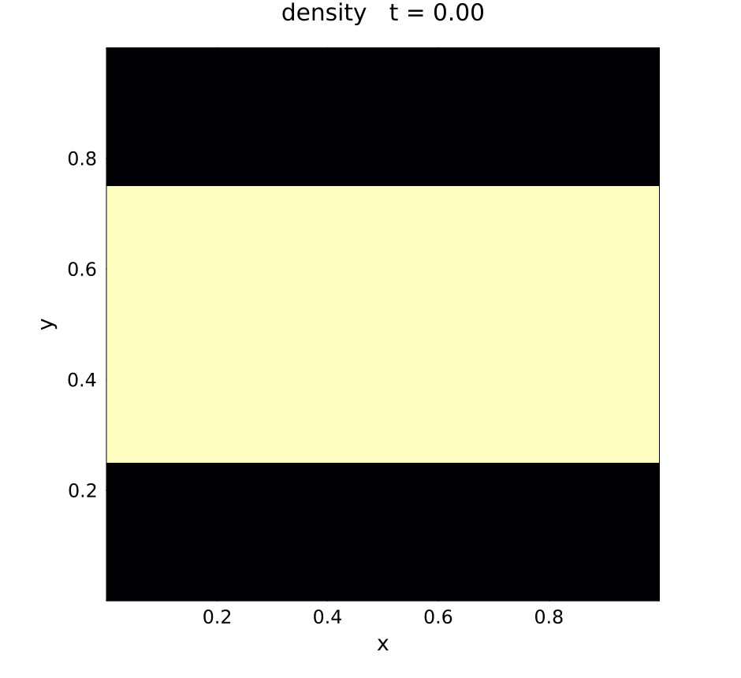 | 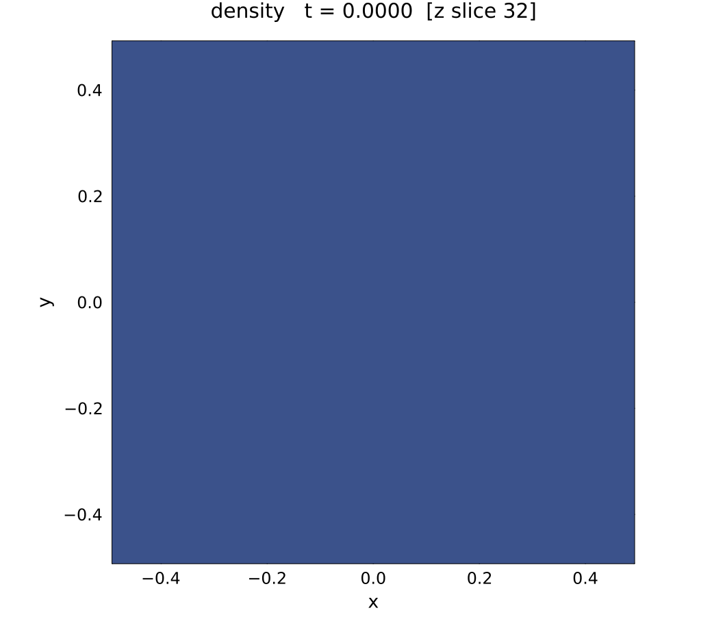 |
| $512^2$, PPM + SSPRK3 | density in the mid-plane slice, $64^3$, PPM + SSPRK3 |
| **M1 radiation shadow** | **Orszag-Tang MHD vortex** |
| 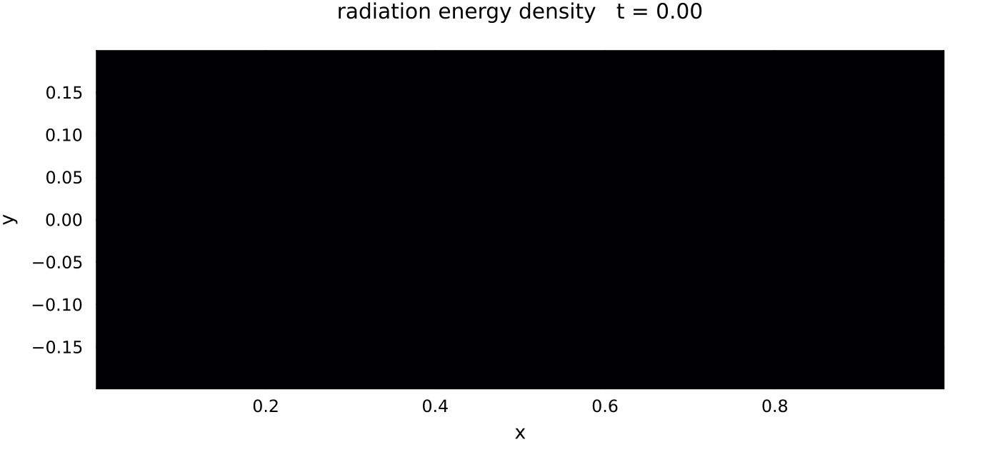 | 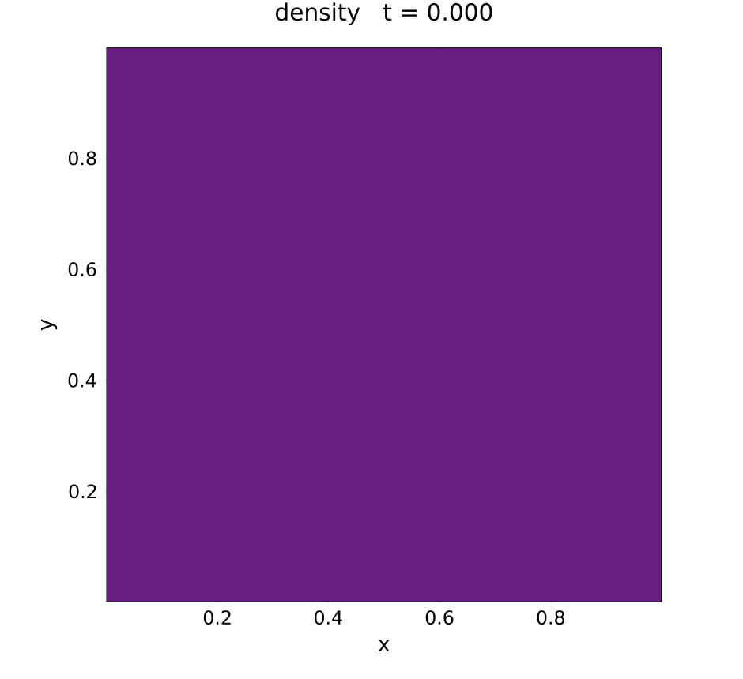 |
| $500\times200$, a beam striking an opaque clump; colour is $\log_{10}E_r$ over ten decades | density, $256^2$, HLLD + constrained transport, PPM + SSPRK2 |

## What it solves

**Hydrodynamics.** The compressible Euler equations,

$$\partial_t \rho + \nabla\cdot(\rho\mathbf{v}) = 0, \qquad \partial_t (\rho\mathbf{v}) + \nabla\cdot(\rho\mathbf{v}\mathbf{v} + P\mathbb{I}) = \mathbf{f}_\mathrm{rad}, \qquad \partial_t E + \nabla\cdot[(E+P)\mathbf{v}] = \dot{e}_\mathrm{rad},$$

with an ideal-gas equation of state.

**Magnetohydrodynamics.** With `Simulation(mhd = true)`, the equations of ideal MHD, with the field face-centred and advanced by constrained transport, so that $\nabla\cdot\mathbf{b}$ stays at round-off. The scheme is Quokka's: the HLLD Riemann solver, the Q26 EMF and [Londrillo & Del Zanna (2004)](https://scixplorer.org/abs/2004JCoPh.195...17L/abstract) averaging; with piecewise-constant reconstruction it reproduces Quokka's shock tubes to round-off. Radiation and photochemistry run on a magnetised gas.

**Radiation.** The first two angular moments of the radiative transfer equation, closed with the [Levermore (1984)](https://scixplorer.org/abs/1984JQSRT..31..149L/abstract) M1 closure,

$$\partial_t E_r + \frac{\hat{c}}{c}\nabla\cdot\mathbf{F}_r = S, \qquad \partial_t \mathbf{F}_r + \hat{c}\,c\,\nabla\cdot(\mathbb{T}E_r) = \mathbf{S}_F,$$

where $\mathbb{T}(\mathbf{f})$ is the Eddington tensor built from the reduced flux $\mathbf{f} = \mathbf{F}_r/(cE_r)$. Unlike flux-limited diffusion, M1 interpolates between the free-streaming limit ($\mathbb{T}\to\hat{n}\hat{n}$, where radiation travels in straight lines and casts shadows) and the diffusion limit ($\mathbb{T}\to\mathbb{I}/3$).

Each frequency group carries its own pair of moment equations. The default is a single grey group; see [Multigroup radiation](#multigroup-radiation).

## Numerical method

Space and time are separated by the method of lines: a spatial operator $L(U) = -(F_{i+1/2}-F_{i-1/2})/\Delta x$ is assembled once per stage, and the stages are pure ODE updates.

| Component | Choice |
|:---|:---|
| Reconstruction | piecewise constant (`PCM`), piecewise linear (`PLM`, four limiters), piecewise parabolic (`PPM`) |
| Hydro Riemann solver | `HLLC` (default) with Batten wave speeds, Rider's nonlinear correction, and the [Minoshima & Miyoshi (2021)](https://scixplorer.org/abs/2021JCoPh.44610639M/abstract) carbuncle cure and low-dissipation pressure; or `LLF` |
| MHD | `HLLD` (default; [Miyoshi & Kusano 2005](https://scixplorer.org/abs/2005JCoPh.208..315M/abstract) with the [Minoshima & Miyoshi 2021](https://scixplorer.org/abs/2021JCoPh.44610639M/abstract) corrections), `LLFMHD` or `HLLMHD`; constrained transport with the Q26 EMF and LD04 averaging |
| Radiation Riemann solver | `HLL` on the M1 system with frozen-Eddington-tensor wave speeds ([Skinner & Ostriker 2013](https://scixplorer.org/abs/2013ApJS..206...21S/abstract); [Balsara 1999](https://scixplorer.org/abs/1999JQSRT..61..617B/abstract)) |
| Hydro time integration | SSP Runge-Kutta, first to third order (`ForwardEuler`, `SSPRK2` (default), `SSPRK3`) |
| Radiation time integration | IMEX PD-ARS: transport explicit, stiff matter coupling implicit; second order and asymptotic-preserving |
| Matter-radiation coupling, grey | 2×2 Newton-Raphson per cell in $(E_\mathrm{int}, R)$, with an analytic flux/momentum update and a lagged outer iteration for the $\mathbf{v}\cdot\mathbf{F}$ work term |
| Matter-radiation coupling, $N_g$ groups | a $(1+N_g)$-dimensional implicit solve per cell, by one of three interchangeable [coupling solvers](#matter-radiation-coupling-solvers) |

Radiation subcycles inside each hydro step at the reduced speed of light $\hat{c}$. A degenerate direction (`n[d] == 1`) carries no ghost cells and is skipped entirely, so 1D and 2D problems cost what they should.

## Install and run

Honghu requires Julia 1.10 (the LTS release) or newer. There are two ways to install it.

**1. As a package.** In the Julia REPL, in the environment of your own project:

```julia
using Pkg; Pkg.develop(url = "https://github.com/chongchonghe/Honghu.jl")
using Honghu

# optionally, install Plots package for plotting
Pkg.add("Plots")
```

`Pkg.develop` clones the repository into `~/.julia/dev/Honghu`, so you can read and edit the source there.

**2. From a clone.** Clone the repository and start Julia in it, with the repository as the active project:

```bash
# optionally, install Plots for plotting in the global environment
julia -e 'using Pkg; Pkg.add("Plots")'

git clone https://github.com/chongchonghe/Honghu.jl
cd Honghu.jl
julia --project=. -e 'using Pkg; Pkg.instantiate()'   # once, to install the dependencies
julia --project=. -t auto                             # start Julia with threads
```

Then, in the Julia REPL:

```julia
using Honghu
```

A shock tube in five lines:

```julia
sim = Simulation(n = (256, 1, 1), eos = IdealGas(gamma = 1.4), boundaries = Boundaries(Outflow()))
set_initial_conditions!(sim) do x, y, z
    x < 0.5 ? (rho = 1.0, p = 1.0) : (rho = 0.125, p = 0.1)
end
run!(sim, tmax = 0.2)
```

Optionally, plot the result with `plotstate` (it needs `using Plots`, see [Plotting](#plotting)):

```julia
using Plots
p = plotstate(sim)
display(p)      # density against x
plotpanels(sim) # density, speed, pressure, temperature
```

If no window opens, see [Plotting](#plotting).

A 3D radiation-hydrodynamics run, writing snapshots for ParaView:

```julia
rad = RadiationPhysics(c = 2.998e10, chat = 2.998e8, a_rad = 7.5657e-15,
                       opacity = ConstantOpacity(0.4))
sim = Simulation(n = (128, 128, 128), xhi = (1e15, 1e15, 1e15),
                 eos = IdealGas(gamma = 5/3, cv = cv_from_mu(0.6, 5/3)),
                 radiation = rad, boundaries = Boundaries(Outflow()))
set_initial_conditions!(sim) do x, y, z
    (rho = 1e-20, T = 10.0, Erad = 7.5657e-15 * 10.0^4)
end
run!(sim, tmax = 1e5, outdir = "out", dtout = 1e4)
```

Honghu has defined a set of standard test problems that are ready to run in `Honghu.Problems`, listed in [Built-in problems](#built-in-problems). Each returns `(sim, tmax)`, a simulation with its initial conditions set and the end time of the test, ready to `run!`. Here the 3D Sedov blast at $128^3$ runs to $t = 0.001$ (short of its `tmax`):

```julia
sim, tmax = Honghu.Problems.sedov_blast(n = 128)
run!(sim; tmax = 0.001)
display(plotstate(sim, var = :speed))
plotpanels(sim) # density, speed, pressure, temperature
```

`run!` ends by printing its performance. On 4 threads of an Apple M5 Max it reads

```
done: 88 steps, t = 0.001, 16.29 s (1.13e+07 cell-updates/s) on 4 threads
```

`animate_run` takes the place of `run!` when you want an animation: it advances the simulation to `tmax`, draws a frame of `var` at `nframes` evenly spaced times, and writes a GIF. Here the 2D Kelvin-Helmholtz instability at $128^2$ first runs to $t = 1$ with `run!`, writing a VTK snapshot every 0.1 into `kh/` (`data_00000.vti`, ..., for ParaView), and is then animated from $t = 1$ to $t = 3$ into `kh.gif`. On 4 threads the two take about 4 s and 10 s:

```julia
sim, tmax = Honghu.Problems.kelvin_helmholtz(n = 128)
run!(sim; tmax=1, outdir = "kh", dtout = 0.1)
animate_run(sim; tmax=3, nframes = 100, var = :density, fps = 20, filename = "kh.gif", c = :plasma)
```

To run a script with threads (see [Threads](#threads)), for example one of the examples:

```bash
julia --project=. -t auto examples/sod_1d.jl   # from a clone
julia -t auto script.jl                        # with the package installed
```

## Built-in problems

Each returns `(sim, tmax)`, ready to `run!`:

```julia
sim, tmax = Honghu.Problems.kelvin_helmholtz(n = 512)
run!(sim; tmax, outdir = "kh", dtout = 0.02)
```

| Problem | Tests |
|:---|:---|
| `sod_shock_tube` | shocks, contacts, rarefactions against `sod_exact` |
| `smooth_advection` | order of accuracy of the reconstruction |
| `kelvin_helmholtz` | 2D shear instability, exact conservation |
| `sedov_blast` | 3D strong explosion, spherical symmetry on a Cartesian grid |
| `radiation_streaming` | free-streaming limit: the front must move at exactly $\hat{c}$ |
| `radiation_diffusion` | static diffusion limit against an analytic Gaussian |
| `matter_coupling` | stiff energy exchange, equilibrium and exact energy conservation |
| `marshak_wave` | non-equilibrium radiation-driven heat wave |
| `marshak_vaytet` | the same wave with a $\nu^{-2}$ opacity and $N_g$ groups, which a grey run cannot reproduce |
| `radhydro_shock` | Mach 3 radiative shock against the Lowrie & Edwards semi-analytic solution |
| `radiation_shadow` | M1 casting a sharp shadow behind an opaque clump |
| `brio_wu`, `ryu_jones_2a` | MHD shock tubes, against Quokka |
| `alfven_wave` | oblique circularly polarised Alfven wave: second-order convergence of MHD |
| `orszag_tang` | 2D MHD vortex with interacting shocks, $\nabla\cdot\mathbf{b}$ at round-off |

The scripts in `examples/` run and post-process these problems. When Plots is installed, every example writes a figure by default alongside its VTK or text output:

```bash
julia --project=. -t auto examples/sod_1d.jl              # -> sod.png, sod.txt, sod_exact.txt
julia --project=. -t auto examples/sod_1d.jl 1024         # positional arguments still work
julia --project=. -t auto examples/sod_1d.jl --no-plot    # data only, for batch jobs
julia --project=. -t auto examples/sod_1d.jl --outdir=run # send everything somewhere else
```

Without Plots, the examples still write their data files and print a one-line note on how to enable plotting.

## Comparing schemes

`compare` runs a problem across schemes and grid resolutions, scores each run with the problem's metrics, prints a summary table, and writes it to disk.

```julia
using Honghu
const P = Honghu.Problems

compare(P.sod_shock_tube, :riemann, (HLLC(), LLF()); sizes = (64, 128, 256, 512))
```

```
  variant        size       cells       steps      wall_s  l1_density
  HLLC             64          64          69    0.002033     0.01004
  HLLC            128         128         139    0.001882    0.004942
  ...
  (zero for every run: floors, newton_mean, newton_max, newton_failures)
  convergence rate, -dlog(metric)/dlog(size):
  variant  l1_density
  HLLC           0.95
  LLF            0.97
```

You can sweep any keyword that the problem forwards to `Simulation` (such as `:reconstruction`, `:integrator`, `:closure`, or `:cfl`), and each value labels its own rows. When a variant needs more than one keyword, pass a NamedTuple of keyword sets:

```julia
compare(P.radhydro_shock, (P1 = (closure = EddingtonClosure(),),
                           M1 = (closure = LevermoreClosure(),)); sizes = (64, 128, 256))
```

Under the hood, a variant is a builder function mapping resolution to `(sim, tmax)`, the same signature used by the built-in problem factories. Passing builders directly lets variants differ in initial conditions, geometry, or global settings:

```julia
compare(["flat"  => nx -> setup(nx, amplitude = 0.1),
         "steep" => nx -> setup(nx, amplitude = 0.9)];
        sizes = (64, 128, 256), metrics = default_metrics(P.smooth_advection))
```

Every built-in problem takes `n` for resolution (with `nx` accepted as an alias).

You can also pass simulations you have already constructed:

```julia
a, _ = P.sod_shock_tube(n = 256, riemann = HLLC())
b, _ = P.sod_shock_tube(n = 256, riemann = LLF())
compare("HLLC" => a, "LLF" => b; tmax = 0.2, metrics = default_metrics(P.sod_shock_tube))
```

Because a `Simulation` instance has a fixed grid, passing pre-built simulations runs a single resolution without a convergence rate, and `plotcompare` renders the result as a bar chart. You must supply `tmax` because `Simulation` does not store a stopping time; `compare` runs the simulations in place so you can plot them afterward.

Each row also records `steps`, `wall_s`, `floors`, and the Newton iteration counts, showing whether a lower error came from taking smaller steps or hitting the positivity floors. The first run of each variant is a warm-up that is discarded before timing.

`compare` writes the table to a text file stamped with the git commit hash, and `plotcompare` reads that file directly:

```julia
using Plots
plotcompare("sod_shock_tube_riemann_compare.txt",
            "smooth_advection_riemann_compare.txt")   # the same schemes, two problems
```

Problems with an exact or reference solution define `default_metrics` in `src/problems/metrics.jl`; for other problems, pass `metrics = (; name = sim -> ...)` explicitly.

`examples/compare_schemes.jl` compares HLLC and LLF on both a shock tube and a smooth advection wave.

## Verification

Every figure below is regenerated by `julia --project=. -t auto docs/make_figures.jl`, or by running the test suite with `--figures`. Each compares the code against something independent: an exact Riemann solution, an analytic diffusion solution, a measured convergence slope, or a similarity solution.

```bash
julia --project=. -t 4 test/runtests.jl             # 2430 tests, ~2.5 min
julia --project=. -t auto test/runtests.jl --figures # ... and redraw the figures below
```

| | |
|:---:|:---:|
| 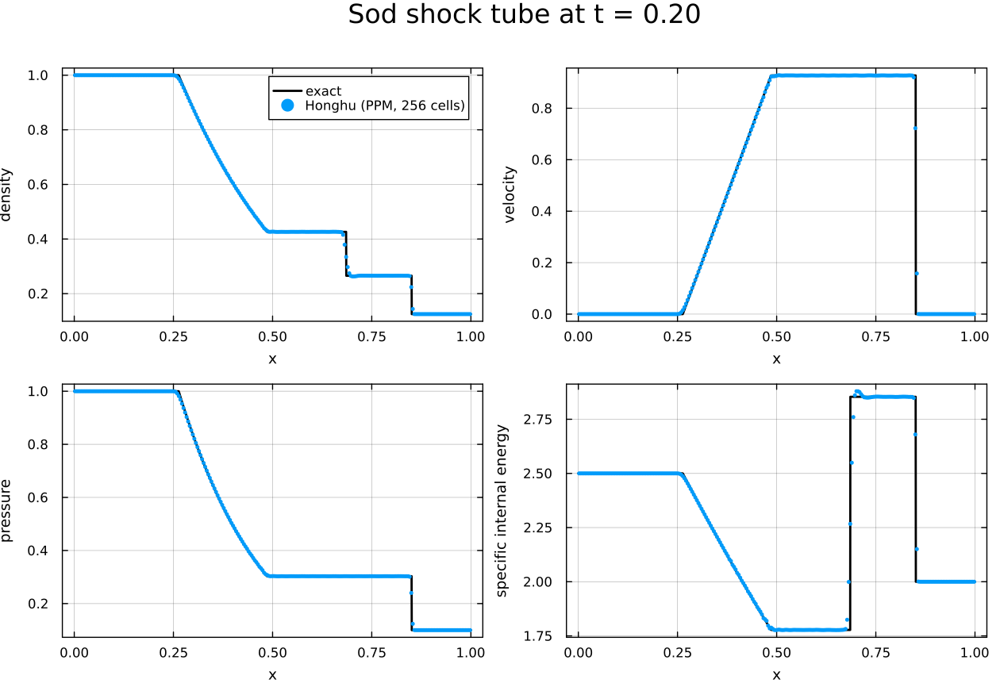 | 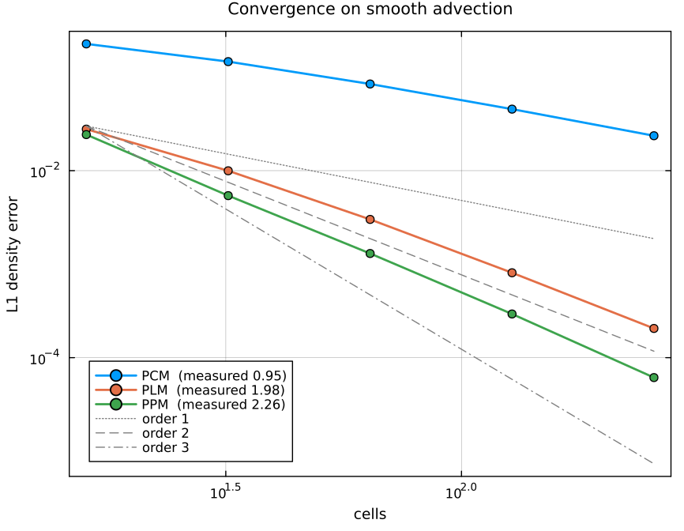 |
| **Sod shock tube** against the exact Riemann solution at $t = 0.2$, 256 cells. | **Order of accuracy** on smooth advection. PCM, PLM and PPM sit on their expected slopes. |
| 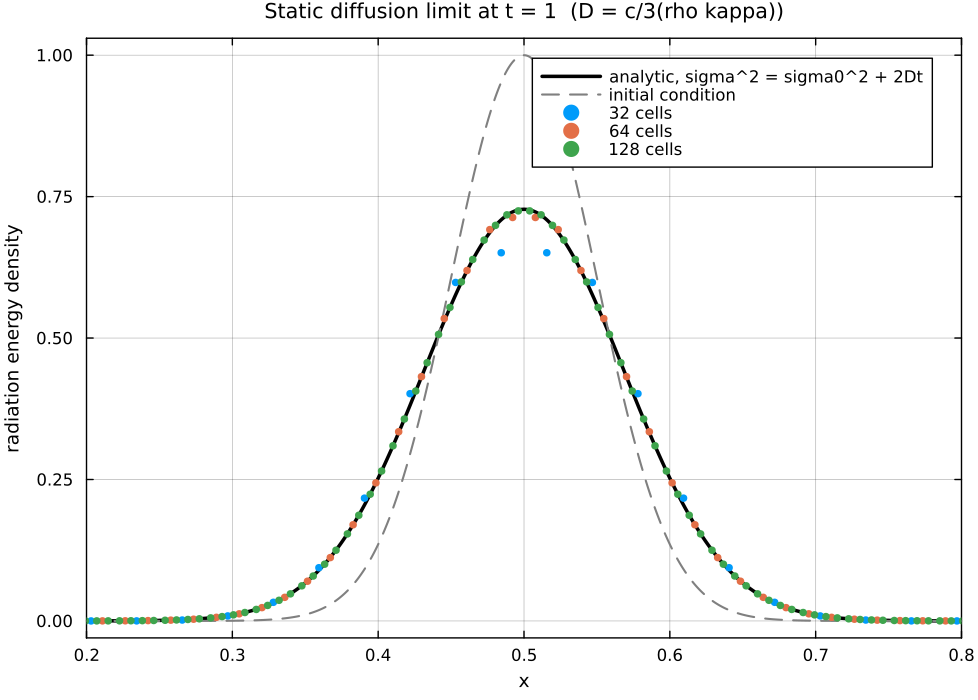 | 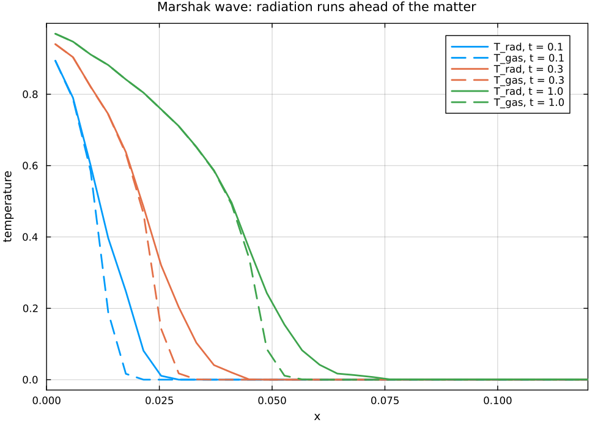 |
| **Static diffusion limit** against the analytic Gaussian $\sigma^2 = \sigma_0^2 + 2Dt$. The answer is independent of how many mean free paths a cell spans, which is the asymptotic-preserving property. | **Marshak wave**: radiation runs ahead of the matter, so $T_{\rm rad}$ and $T_{\rm gas}$ separate at the front and merge behind it. |
| 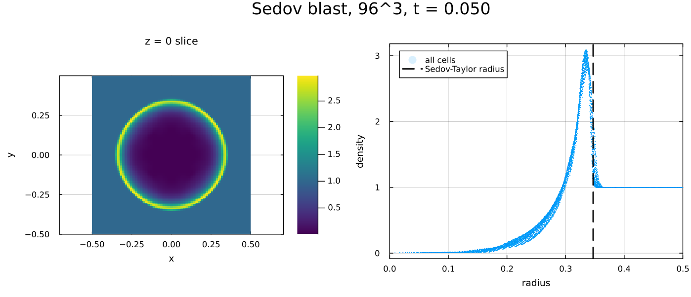 | 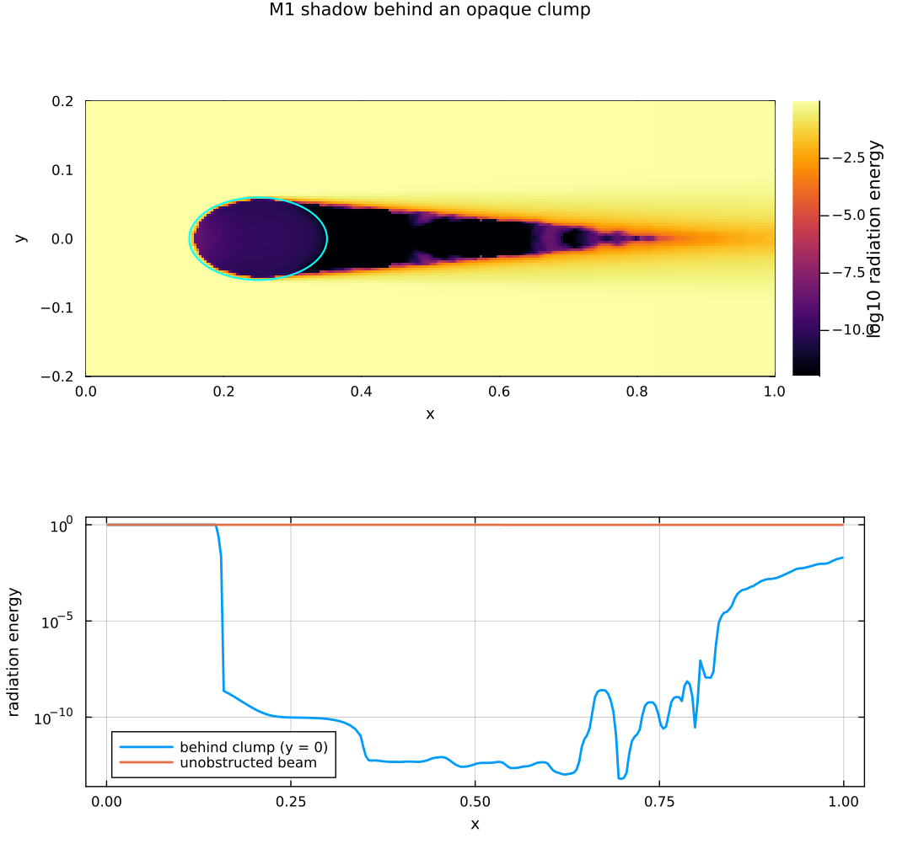 |
| **Sedov blast**, $96^3$. Every cell in the box collapses onto one radial profile, and the shock sits on the Sedov-Taylor radius. | **M1 shadow**. The clump removes the beam over ten decades; a diffusion-based scheme would let radiation leak around it. |

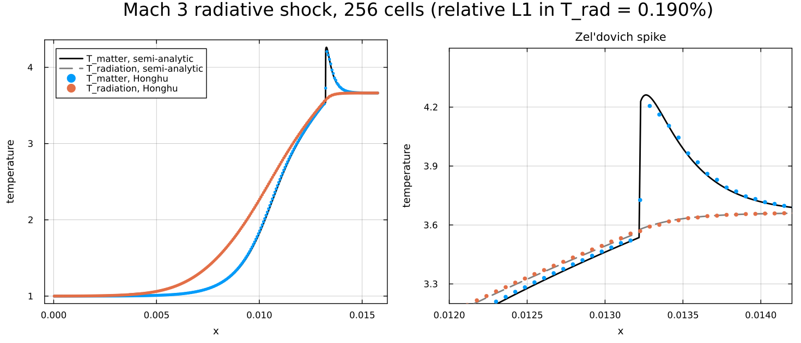

**Mach 3 radiative shock** ([Lowrie & Edwards 2008](https://scixplorer.org/abs/2008ShWav..18..129L/abstract)), against the semi-analytic solution. This optically thick, strongly coupled shock has a radiative precursor ahead of the front and a Zel'dovich spike just behind it, where the matter temperature overshoots its downstream equilibrium value ($4.26$ against $3.66$). Capturing the spike requires the velocity-dependent coupling terms, the implicit solve, and the shock-capturing reconstruction to work together. Relative $L_1$ error in $T_\mathrm{rad}$ is $0.19\%$ at 256 cells, compared with Quokka's $1\%$ tolerance.

The test suite (`julia --project=. -t 4 test/runtests.jl`, 2430 tests, ~2.5 min) checks:

- Smooth-advection convergence rates of 1 for PCM, 2 for PLM, and 2.3 for PPM (PPM stops below 3 because the Colella-Woodward monotonicity constraint flattens the parabola at the two extrema of the sine wave, as in Athena++ and Quokka).
- Toro's five shock tubes, including the "123" near-vacuum problem and both strong blasts, without triggering positivity floors.
- Conservation of mass, momentum, and total energy to $10^{-14}$ relative on periodic boundaries, and bitwise-comparable profiles when the same 1D problem is run along $x$, $y$, or $z$.
- Radiation free streaming with the front arriving at $\hat{c}t$ to 2% and $|\mathbf{F}| \le cE$ everywhere, and static diffusion with relative $L_1$ errors of 0.6%, 0.13%, and 0.06% at 64, 128, and 256 cells against the analytic Gaussian regardless of cell optical depth.
- Stiff matter-radiation coupling: a single step $10^{5}$ times longer than the coupling time lands on radiative equilibrium while conserving $E_\mathrm{int} + (c/\hat{c})E_r$ to $10^{-13}$, and radiation momentum transfer matches $\Delta p = (\rho\kappa/c)F_0(1-e^{-\hat{c}\rho\kappa t})/(\hat{c}\rho\kappa)$ to 1% with second-order convergence.
- The Mach 3 radiative shock to $0.19\%$ relative $L_1$ error in $T_\mathrm{rad}$ at 256 cells against the semi-analytic solution, with the Zel'dovich spike at $4.21$ (exact $4.26$) and zero positivity floor repairs.
- Multigroup consistency: at $N_g = 1$ the multigroup source step matches the grey 2×2 driver to round-off across $\kappa \in [0, 10^9]$, an optically thick multigroup cell relaxes onto $a_rT^4f_g(T)$ in every group, and at intermediate optical depths the two single-step coupling solvers converge toward the error-controlled ODE reference at second order in $\Delta t$.

## Performance

The cost of one step, per cell and per CPU core, for the same 3D blast wave at $128^3$ in three forms: the Sedov blast of `Honghu.Problems.sedov_blast`; the same blast with grey M1 radiation coupled to the gas ($\kappa = 100$, about one optical depth per cell, one radiation substep per step); and the same blast in a uniform magnetic field ($\beta = 1$ in the ambient gas). All three use PLM and SSP-RK2, with HLLC for the hydrodynamics and HLLD with constrained transport for MHD. One thread on a laptop (Apple M5 Max), Julia 1.13, `Float64`, measured 2026-11-28:

| | Hydrodynamics (blast wave) | Radiation hydrodynamics (blast wave + grey M1) | Magnetohydrodynamics (magnetised blast wave) |
|:---|---:|---:|---:|
| **Mcell-updates per CPU-second** | **8.32** | **3.34** | **3.38** |
| **CPU-ns per cell-update** | **120** | **299** | **296** |
| reconstruction (PLM) | 16 | 17 | 28 |
| Riemann solver (HLLC, HLLD) | 84 | 84 | 170 |
| flux divergence and stage update | 10 | 10 | 11 |
| EMF and induction (constrained transport) | — | — | 49 |
| radiation transport (HLL) | — | 112 | — |
| matter-radiation coupling (implicit) | — | 53 | — |
| conversions and floors | 6 | 11 | 13 |
| ghost cells | 0.4 | 0.4 | 11 |
| time step | 1 | 1 | 3 |
| other (copies, combines) | 4 | 11 | 10 |

The rows below the totals are CPU-ns per cell-update and add up to the total: a profile of whole steps assigns each sample to the kernel it was in, and the radiation rows hold everything under the transport operator and the coupling solve, ghost cells and floors included. A radiation run with more substeps per step pays the two radiation rows once per substep. With radiation, reconstruction and the Riemann solver cost what they cost without it, and MHD costs 2.5 times hydrodynamics, mostly in the HLLD solver and the edge-centred EMFs. To measure it on your machine:

```bash
julia --project=. -t 1 test/benchmarks.jl        # prints this table; an argument sets n
```

Allocation per step is flat in the grid size (152 KiB for hydrodynamics, 284 KiB with radiation, all of it threading overhead), and `test/test_performance.jl` asserts that every hot kernel stays below 8 bytes per cell to guard against closure-boxing regressions.

### Threads

Honghu runs as one process and spreads its grid loops over Julia's threads, one row of cells, `(j, k)`, per task. The number of threads is set when Julia starts and cannot change in a running session:

```bash
julia --project=. -t 6 script.jl                  # 6 threads
julia --project=. -t auto script.jl               # as many threads as Julia counts CPUs
JULIA_NUM_THREADS=6 julia --project=. script.jl   # the same as -t 6
```

In the REPL, `Threads.nthreads()` gives the number, and the line `run!` prints at the end says how many threads the run used. A 1D run has a single row, so it runs on one thread whatever `-t` asks for; 2D and 3D runs use all of them. On the Apple M5 Max below, which has 6 performance and 12 efficiency cores, `-t auto` gives 6 threads.

The 3D Sedov blast at $128^3$, `Honghu.Problems.sedov_blast(n = 128, reconstruction = PLM())` with SSP-RK2, the default, 20 steps after one warm-up step, Apple M5 Max, Julia 1.13, measured 2026-11-28:

| Threads | 20 steps | per step | throughput |
|:---|---:|---:|---:|
| 1 | 5.11 s | 0.256 s | 8.21 Mcell-updates/s |
| 4 | 1.83 s | 0.091 s | 22.9 Mcell-updates/s |

Four threads are 2.8 times faster than one. To measure it on your machine, save this as `sedov_timing.jl` and run it with `-t 1` and with `-t 4`:

```julia
using Honghu
sim, _ = Honghu.Problems.sedov_blast(n = 128, reconstruction = PLM())
step!(sim)                                         # warm-up: compiles the step
t = @elapsed for _ in 1:20; step!(sim); end
println(Threads.nthreads(), " threads: ", t / 20, " s per step")
```

```bash
julia --project=. -t 1 sedov_timing.jl
julia --project=. -t 4 sedov_timing.jl
```

#### On a compute node

On a 32-core workstation node (AMD Threadripper PRO 7975WX, one NUMA domain), the Sedov blast with PPM and SSP-RK3, the defaults before 2026-11-27, measured with `test/benchmarks_parallel.jl`:

| threads | $128^3$ per step | $256^3$ per step |
|---:|---:|---:|
| 1 | 1.20 s | 9.5 s |
| 8 | 0.20 s | 1.63 s |
| 16 | 0.115 s | 0.88 s |
| 32, pinned | 0.082 s | 0.67 s |
| 64, pinned | 0.078 s | 0.64 s |

From 8 threads on, the hydrodynamic sweeps run on cache-sized boxes of cells rather than whole-grid passes (`Simulation(tile = :auto)`, the default), which lets them keep scaling after the memory bus saturates (on Apple Silicon tiling was slower at every thread count, so `:auto` leaves it off there). When a job has the whole node, pinning threads with `JULIA_EXCLUSIVE=1 julia -t 32` (one thread per physical core, where CPUs `0` to `31` are the physical cores as shown by `lscpu -e`) improves 32-thread speed by about 10%. Avoid pinning a job that uses only part of the node: pinned to CPUs `0` to `15`, a 16-thread run gets only two of the four L3 caches and runs 20% slower than unpinned. Hyperthreads (`-t 64`) add about 5%. `docs/parallel-findings.md` records the full measurements.

**Memory.** Buffers scale as roughly `72 * ncells * 8` bytes when grey radiation is enabled and `35 * ncells * 8` without, where `ncells` includes ghost cells. A $128^3$ radiation-hydrodynamics run uses about 1.4 GB; pure hydrodynamics at $128^3$ uses about 0.7 GB. Every radiation buffer has `4 * ngroups` components per cell, so the radiation half of that footprint scales linearly with the number of frequency groups.

## Output

- `write_vtk(sim, path)` writes a self-contained `.vti` image-data file with raw appended binary and no external library dependencies. ParaView, VisIt, and yt open it directly, and a numbered series (`data_00000.vti`, `data_00001.vti`, ...) loads as a time series.
- `write_line(sim, path; dir, at)` writes a plain-text table along one axis for plotting 1D profiles such as shock tubes and Marshak waves.
- `save_checkpoint` / `load_checkpoint!` read and write raw binary restart files.

`run!(sim; tmax, outdir, dtout)` writes VTK snapshots on a fixed cadence and trims the step so that it lands exactly on the output times.

## Plotting

`field(sim, name)` extracts any named quantity as a plain `(nx, ny, nz)` array and needs no packages:

```julia
rho, label = field(sim, :density)
available_fields(sim)   # :density, :vx, :speed, :pressure, :temperature, :mach, :Erad, :Trad, ...
```

Loading Plots activates a package extension that adds the plotting methods. They pick the representation from the dimensionality: a line in 1D, a heat map in 2D, a mid-plane slice in 3D.

```julia
using Plots, Honghu

sim, tmax = Honghu.Problems.kelvin_helmholtz(n = 128)
run!(sim; tmax)

plot(sim)                                  # a recipe, so plot/plot! work directly
plotstate(sim, var = :Erad, logscale = true)
plotpanels(sim)                            # density, speed, pressure, temperature (+ radiation)
```

`animate_run` makes an animation on the fly: it takes the place of `run!`, advancing the simulation to `tmax` and drawing a frame at `nframes` evenly spaced times, then writes a GIF. It needs no snapshots on disk:

```julia
sim, tmax = Honghu.Problems.kelvin_helmholtz(n = 256)
animate_run(sim; tmax, nframes = 100, var = :density, fps = 20,
            filename = "kh.gif", c = :magma)   # further keywords go to plotstate
```

Calling any of them before loading Plots prints instructions on loading it.

In the REPL or VS Code, `display` opens the figure in a GR window. When running a script from the command line (`julia script.jl`), the process exits as soon as the script finishes, closing the window; call `readline()` after `display` to keep the window open, or save directly to disk with `savefig(plotstate(sim), "sod.png")`. Note that the scripts in `examples/` include `examples/common.jl`, which sets `ENV["GKSwstype"] = "100"` so GR renders off-screen without opening a window; unset that variable or set it to `"gksqt"` if you want interactive windows from an example script.

`docs/make_figures.jl` and `docs/make_animations.jl` regenerate everything shown above.

## Layout

```
Honghu.jl/
  Project.toml   deps: Printf, Dates, LinearAlgebra (stdlibs), OrdinaryDiffEq
                 and SciMLBase; Plots is a weak dependency
  README.md      this file
  CLAUDE.md      invariants, performance traps, and a per-file guide to src/
  logs.md        development log: what was asked for, what was built, why
  future.md      work not done, with enough detail to start; known bugs
  src/           the package -- 33 files, one concern each
    planck.jl    the incomplete Planck integral and RadiationGroups
    newton.jl    the linear solve of one Newton step on a bordered system
    coupling*.jl the coupling interface and the three solvers behind it
    riemann/     one Riemann solver per file, mirroring Quokka's headers
    problems/    built-in problems, exact solutions, per-problem metrics
  ext/           plotting methods, loaded only when Plots is present
  test/          the test suite, plus benchmarks.jl
  docs/          make.jl (the documentation site), make_figures.jl,
                 make_animations.jl, the generated figures/, technical notes
  examples/      sod_1d, kelvin_helmholtz_2d, sedov_3d, compare_schemes,
                 marshak_wave, radiation_shadow, radiating_blast_3d
```

The include order in `src/Honghu.jl` is significant, because later files use types defined earlier. `CLAUDE.md` has the file-by-file table and the invariants each layer relies on.

## Extending

The code is built around small, dispatch-based interfaces. To add your own piece of physics, define a type and a few methods:

```julia
struct KramersOpacity <: Honghu.AbstractOpacity end
Honghu.planck_opacity(::KramersOpacity, rho, T) = 4e25 * rho * T^-3.5
Honghu.flux_mean_opacity(op::KramersOpacity, rho, T) = Honghu.planck_opacity(op, rho, T)
Honghu.energy_mean_opacity(op::KramersOpacity, rho, T) = Honghu.planck_opacity(op, rho, T)
```

The same pattern works for `AbstractEOS`, `AbstractOpacity`, `AbstractLimiter`, `AbstractReconstruction`, `AbstractIntegrator`, `AbstractRiemannSolver`, `AbstractClosure` and `BoundaryCondition`. `test/test_extensions.jl` defines a toy subtype of every one of them and runs a simulation with it, so it doubles as copy-paste documentation of exactly which methods each interface needs.

## Multigroup radiation

The radiation field can be resolved into $N_g$ frequency groups. Each group carries its own energy density and flux through the same M1 solver, and exchanges energy with the gas through its own opacity:

$$\partial_t E_g + \frac{\hat{c}}{c}\nabla\cdot\mathbf{F}_g = \hat{c}\rho\left(\kappa_{P,g}\,a_rT^4f_g(T) - \kappa_{E,g}E_g\right), \qquad g = 1,\dots,N_g,$$

where $f_g(T)$ is the fraction of a Planck spectrum at $T$ that falls in group $g$, computed as the difference of the normalised incomplete Planck integral $P(x) = (15/\pi^4)\int_0^x t^3/(e^t-1)\,\mathrm{d}t$ at the group edges ($x = h\nu/k_BT$). Quokka tabulates $P$ and interpolates; Honghu evaluates it directly with the Bernoulli expansion below $x = 1$ and the exponential tail above, avoiding table generation. The last group takes $1 - \sum(\mathrm{rest})$, so the fractions sum to one and the total emitted energy equals $a_rT^4$ to round-off.

**One group is grey and is the default.** Because `ngroups` is a type parameter, every kernel specialises on it and a single-group run dispatches to the 2×2 grey source driver, matching the grey code path to round-off.

**Groups.** `RadiationGroups` takes $N_g + 1$ increasing edges, or a range and a count. `energy_unit * edge` must have units of energy so that $x = \mathrm{energy}/k_BT$ is dimensionless. Pass `CGS.h_planck` when giving edges in Hz, or leave `energy_unit = 1` to specify edges directly in units of $k_BT$ (as the unit-free test problems do).

```julia
RadiationGroups([0.1, 1.0, 5.0, 20.0])                                # three groups, edges in units of k_B T
RadiationGroups(6e10, 6e14, 4; energy_unit = Honghu.CGS.h_planck)     # four log-spaced groups, edges in Hz
RadiationGroups(6e10, 6e14, 4; spacing = :linear)                     # :log is the default, since a Planck spectrum spans decades
```

The outermost edges act as integration limits: the first group integrates down to `edges[1]` and the last up to `edges[end]`. Both `0.0` and `Inf` are valid, and the grey default is `RadiationGroups([0.0, Inf])`.

**Opacity.** Group opacities are piecewise constant across each group and evaluated at the geometric mean $\sqrt{\nu_g\nu_{g+1}}$ of the group edges (matching Quokka's `piecewise_constant_opacity`). Because a constant opacity cancels out of any spectral average within the group, the Planck, energy, and flux means are equal inside each group. `FrequencyOpacity(f)` takes a function `f(nu, rho, T)` and throws an error if used in a single-group run, since a frequency-dependent law has no well-defined grey evaluation point; passing a grey `AbstractOpacity` subtype to a multigroup run assigns that same $\kappa$ to every group (as in Vaytet's constant-opacity model).

**A run.** Pass `groups`, and `k_B` in whatever units the rest of the problem uses:

```julia
using Honghu
const CGS = Honghu.CGS

groups = RadiationGroups(6e10, 6e14, 4; energy_unit = CGS.h_planck)
rad = RadiationPhysics(c = CGS.c_light, a_rad = CGS.a_rad, k_B = CGS.k_B,
                       groups = groups, beta_order = 0,
                       opacity = FrequencyOpacity((nu, rho, T) -> 2000.0 * (nu / 4e13)^-2))

sim = Simulation(n = (64, 1, 1), xhi = (20.0, 1.0, 1.0), radiation = rad, hydro = false,
                 eos = IdealGas(gamma = 5/3, cv = 1.0),
                 boundaries = Boundaries(Outflow()))
set_initial_conditions!(sim) do x, y, z
    (rho = 1e-3, T = 300.0, Erad = CGS.a_rad * 300.0^4)
end
run!(sim, tmax = 1e-8)
```

Passing a scalar `Erad` in the initial conditions specifies the total radiation energy density, which is distributed across groups according to a Planck spectrum at $T_\mathrm{rad} = (E_\mathrm{rad}/a_r)^{1/4}$. A `Fixed` radiation boundary condition is the only place where you must supply all `4 * ngroups` components explicitly; see `Honghu.Problems.marshak_vaytet` for an example using `planck_fractions`.

Diagnostics default to frequency-integrated totals: `field(sim, :Erad)`, `:Fx`, `:reduced_flux`, and `radiation_temperature` sum over all groups, while a trailing index selects an individual group (such as `field(sim, :Erad_2)`). `available_fields` lists per-group field names whenever `ngroups > 1`.

## Matter-radiation coupling solvers

With $N_g \geq 2$ groups, the implicit energy exchange solves a $(1+N_g)$-dimensional stiff system per cell, selected via the `coupling` keyword of `RadiationPhysics`:

```julia
rad = RadiationPhysics(c = 1.0, a_rad = 1.0, opacity = ConstantOpacity(1e3),
                       groups = groups, coupling = QuokkaCoupling())
```

All coupling solvers read the per-group emission rate and absorption coefficient from `coupling_coefficients`, and the opacity law is carried on the cell state so temperature derivatives ($\mathrm{d}\kappa/\mathrm{d}T$ included) are evaluated directly from the opacity model. `BracketedCoupling` and `AdaptiveCoupling` are built on `coupling_coefficients`, whereas `QuokkaCoupling` is a separate hand-derived formulation in Quokka's variables that shares only its initial guess with them.

| Solver | Description and use case |
|:---|:---|
| `BracketedCoupling()` | **Default production solver.** Backward Euler in $(E_\mathrm{gas}, E_g)$, reduced algebraically to a single scalar equation. Because the group equations are linear in $E_g$ at fixed gas temperature, they can be eliminated in closed form, leaving the cell's energy balance as a scalar function of $E_\mathrm{gas}$ on an interval that brackets the root. By default it uses `Brent()` from BracketingNonlinearSolve (averaging 7.7 evaluations per cell), requires no Jacobian or linear solve, allocates zero bytes, and is the only solver that supports dust-gas coupling. Across a 240-cell stress test covering three opacity laws and $\tau_\mathrm{cell}$ from $10^{-4}$ to $10^{12}$, it converges on all 240 cells. See `docs/coupling-new-method.md` for details. |
| `QuokkaCoupling()` | The $(1+N_g)$ Newton-Raphson solver in Quokka's variables $(E_\mathrm{gas}, R_g)$, where $R_g$ is the energy transferred from gas to group $g$ over the step. Solving for $R_g$ removes $\tau = \hat{c}\rho\kappa\Delta t$ from the residual and keeps the Jacobian well-conditioned at high optical depth. Included for structural parity with Quokka and cross-checking against `BracketedCoupling`. On steeply temperature-dependent opacities its unreduced Newton step can point in the wrong direction, failing on 75 of the 240 stress-test cells. |
| `AdaptiveCoupling()` | An error-controlled stiff ODE integrator (`Rosenbrock23` by default) over the coupling step. Intended as a reference solver to verify single-step solvers against a tight ODE tolerance: it takes tens of internal steps per cell, runs 12 to several hundred times slower than the single-step solvers, and allocates 8 to 21 kB per cell. |

`QuokkaCoupling` also accepts a `linsolve` keyword specifying how each $(1+N_g)\times(1+N_g)$ Newton step is solved. The default, `ArrowheadSolve()`, eliminates the diagonal group block into the gas row in $O(N_g)$ time without forming a matrix; `DenseSolve()` runs a dense LU factorisation on the full matrix. Both `ArrowheadSolve` and `BracketedCoupling`'s closed-form elimination rely on groups coupling only through the gas; adding direct group-to-group exchange (such as Compton redistribution or line overlap) would require `DenseSolve`.

Cells that reach `max_iterations` without converging increment `newton_failures` in the run summary rather than throwing an exception. See [`future.md`](future.md) for a reproduction of `QuokkaCoupling` failing to converge when a hot gas cools through a steeply falling opacity.

Single-group runs without dust bypass `coupling` and use the inline 2×2 Newton driver in `src/source_terms.jl` (controlled by `tolerance` and `max_iterations` on `RadiationPhysics`). Setting a dust model routes single-group runs through the multigroup driver and `BracketedCoupling`.

## Source terms

`source = f(x, y, z, t)` specifies a volumetric radiation energy source and is folded into the implicit matter-radiation coupling step, which keeps stiff emission terms stable.

`strang_sources = f(sim, t, dt, order)` is a general operator-split hook called for $\Delta t/2$ before the time step and $\Delta t/2$ after it, mutating `sim.U` and `sim.R` in place. It matches Quokka's `addStrangSplitSources` and is where external forces such as gravity, driving, or optically thin cooling can be attached. Applying two half-steps gives second-order accuracy in time (the trapezoid rule, which integrates linear-in-time sources exactly).

```julia
function gravity!(sim, t, dt, order)
    g = sim.grid
    for k in g.lo[3]:g.hi[3], j in g.lo[2]:g.hi[2], i in g.lo[1]:g.hi[1]
        rho = sim.U[Honghu.IRHO, i, j, k]
        dp = -9.8 * rho * dt
        sim.U[Honghu.IEGAS, i, j, k] += dp * (sim.U[Honghu.IMY, i, j, k] + dp / 2) / rho
        sim.U[Honghu.IMY, i, j, k] += dp
    end
end

Simulation(n = (64, 64, 1), strang_sources = gravity!)
```

Honghu does not ship built-in gravity, cooling, or driving modules; `strang_sources` provides the hook to add them without modifying `step!`. The `order` argument (`SourceForward` or `SourceReverse`) lets you reverse the sequence of multiple non-commuting operators between the two half-steps.

## Units

Honghu is unit-agnostic: `c`, `a_rad`, `cv` and the opacities are all supplied by you. Use `Honghu.CGS` for CGS constants, or set `c = a_rad = cv = 1` and work in code units, as the built-in radiation problems do.

## Choosing radiation parameters

Two dimensionless ratios determine whether a radiation-hydrodynamics setup is in the regime these equations model:

**Radiation-to-gas energy, $a_r T^4 / (\rho c_v T)$.** These equations are non-relativistic and keep only $O(v/c)$ terms in the coupling. A radiation energy density that dominates the gas by many orders of magnitude will accelerate the matter towards $c$, outside the validity of the $O(v/c)$ expansion. Because the ratio scales as $T^3/\rho$, a hot, tenuous medium becomes radiation-dominated quickly: at $10^5$ K, gas domination requires $\rho \gtrsim 4\times10^{-8}\ \mathrm{g\,cm^{-3}}$. Keep the ratio of order unity or below unless the gas remains non-relativistic.

**Reduced speed of light, $\hat{c} / \max(|v| + c_s)$.** The reduced speed of light must still outrun every fluid signal; a factor of about 20 is typical. Lowering $\hat{c}$ increases the radiation timestep (`max_radiation_substeps` caps how many radiation substeps one hydro step may take, shrinking the hydro step if needed), at the cost of rescaling the radiation diffusion coefficient by $\hat{c}/c$. Set $\hat{c} = c$ whenever the static diffusion limit matters quantitatively.

See `examples/radiating_blast_3d.jl` for an example that checks both ratios at startup.

## Limitations

- Uniform Cartesian grids on a single shared-memory node (no adaptive mesh refinement or MPI).
- No self-gravity.
- Multigroup opacity is piecewise constant within each group. Power-law in-group profiles (which separate the Planck, energy, and flux group means in Quokka) and direct group-to-group coupling terms such as Compton redistribution are not implemented.
- Lowering $\hat{c}$ below $c$ rescales the static radiation diffusion coefficient by $\hat{c}/c$.
- **The hydrodynamics-radiation split is first order in time.** Each subsystem is second order on its own (SSP-RK2 by default for hydrodynamics and IMEX PD-ARS for radiation), while `step!` advances hydrodynamics and then radiation via first-order Lie splitting, as in Quokka. In typical runs where radiation subcycles many times per hydro step, the splitting error stays well below the spatial discretisation error. User source terms passed via [`strang_sources`](#source-terms) are Strang-split to second order.

## References

Quokka:

- B. D. Wibking & M. R. Krumholz, 2022, "QUOKKA: a code for two-moment AMR radiation hydrodynamics on GPUs", *MNRAS* 512, 1430. [SciX/ADS](https://scixplorer.org/abs/2022MNRAS.512.1430W/abstract)
- C.-C. He, B. D. Wibking & M. R. Krumholz, 2024a, "An asymptotically correct implicit-explicit time integration scheme for finite volume radiation-hydrodynamics", *MNRAS* 531, 1228. [SciX/ADS](https://scixplorer.org/abs/2024MNRAS.531.1228H/abstract)
- C.-C. He, B. D. Wibking & M. R. Krumholz, 2024b, "A novel numerical method for mixed-frame multigroup radiation-hydrodynamics with GPU acceleration implemented in the QUOKKA code", *MNRAS* 535, 3059. [SciX/ADS](https://scixplorer.org/abs/2024MNRAS.535.3059H/abstract)
- C.-C. He, B. D. Wibking, A. Vijayan, M. R. Krumholz & P. S. Li, 2026, "A novel algorithm for GPU-accelerated particle-mesh interactions implemented in the QUOKKA code", *The Open Journal of Astrophysics* 9, 159235. [SciX/ADS](https://scixplorer.org/abs/2026OJAp....959235H/abstract)

Methods and test problems:

- C.-C. He, 2026, Honghu.jl v0.1.0, Zenodo, [doi:10.5281/zenodo.23569082](https://doi.org/10.5281/zenodo.23569082): this code
- [Stone et al. (2020)](https://scixplorer.org/abs/2020ApJS..249....4S/abstract), *ApJS* 249, 4: Athena++, in the speed comparison
- [He, Krumholz & Wibking (2026)](https://scixplorer.org/abs/2026arXiv261121353H/abstract), arXiv:2611.21353: the adaptive reduced speed of light approximation (`StabilityBound`)
- [Colella & Woodward (1984)](https://scixplorer.org/abs/1984JCoPh..54..174C/abstract), *JCP* 54, 174: PPM
- [Toro (2009)](https://doi.org/10.1007/b79761), *Riemann Solvers and Numerical Methods for Fluid Dynamics*: HLLC, exact Riemann solver
- [Miyoshi & Kusano (2005)](https://scixplorer.org/abs/2005JCoPh.208..315M/abstract), *JCP* 208, 315: HLLD
- [Minoshima & Miyoshi (2021)](https://scixplorer.org/abs/2021JCoPh.44610639M/abstract), *JCP* 446, 110639: low-dissipation HLLD, and its HLLC limit
- [Londrillo & Del Zanna (2004)](https://scixplorer.org/abs/2004JCoPh.195...17L/abstract), *JCP* 195, 17: EMF averaging for constrained transport
- [Levermore (1984)](https://scixplorer.org/abs/1984JQSRT..31..149L/abstract), *JQSRT* 31, 149: M1 closure
- [Balsara (1999)](https://scixplorer.org/abs/1999JQSRT..61..617B/abstract), *JQSRT* 61, 617: frozen-Eddington-tensor wave speeds
- [Skinner & Ostriker (2013)](https://scixplorer.org/abs/2013ApJS..206...21S/abstract), *ApJS* 206, 21: M1 wave speeds, reduced speed of light
- [Chu et al. (2019)](https://scixplorer.org/abs/2019JCoPh.389...62C/abstract), *JCP* 389, 62: IMEX PD-ARS
- [Vaytet et al. (2011)](https://scixplorer.org/abs/2011JQSRT.112.1323V/abstract), *JQSRT* 112, 1323: multigroup M1, and the frequency-dependent Marshak wave
- [Lowrie & Edwards (2008)](https://scixplorer.org/abs/2008ShWav..18..129L/abstract), *Shock Waves* 18, 129: radiative shock solutions
- [Zingale (2014)](https://scixplorer.org/abs/2014A%26C.....6...52Z/abstract), *Astronomy and Computing* 6, 52; [Harpole et al. (2019)](https://scixplorer.org/abs/2019JOSS....4.1265H/abstract), *JOSS* 4, 1265: pyro

## Contributing, support and citing

Questions, bug reports and feature requests are welcome on the [issue tracker](https://github.com/chongchonghe/Honghu.jl/issues). [CONTRIBUTING.md](https://github.com/chongchonghe/Honghu.jl/blob/main/CONTRIBUTING.md) explains how to report a problem, how to propose a change, and how to run the tests and the documentation build. Everyone taking part is expected to follow the [code of conduct](https://github.com/chongchonghe/Honghu.jl/blob/main/CODE_OF_CONDUCT.md). Honghu is maintained by its author, who reads every issue and decides what is merged.

If you use Honghu in your research, please cite the Zenodo record of the version you used; for v0.1.0 that is [10.5281/zenodo.23569082](https://doi.org/10.5281/zenodo.23569082). Every release is archived on Zenodo, and the DOI [10.5281/zenodo.23569081](https://doi.org/10.5281/zenodo.23569081) always resolves to the latest version; each version also has its own DOI, listed on that page. [CITATION.cff](https://github.com/chongchonghe/Honghu.jl/blob/main/CITATION.cff) holds the metadata, and GitHub's "Cite this repository" button formats it.

## License

MIT; see [LICENSE](https://github.com/chongchonghe/Honghu.jl/blob/main/LICENSE).

## Author

[Chong-Chong He](https://chongchonghe.github.io/) (chongchong.he@anu.edu.au).
