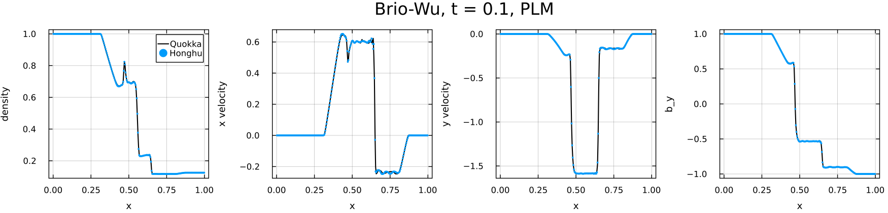
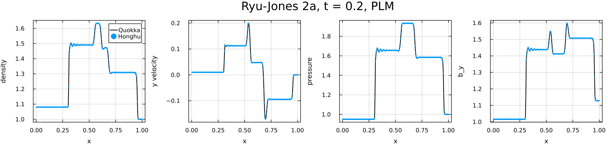
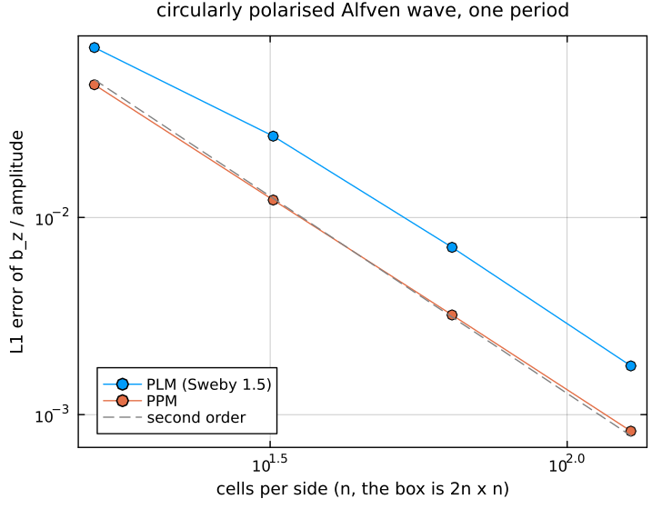
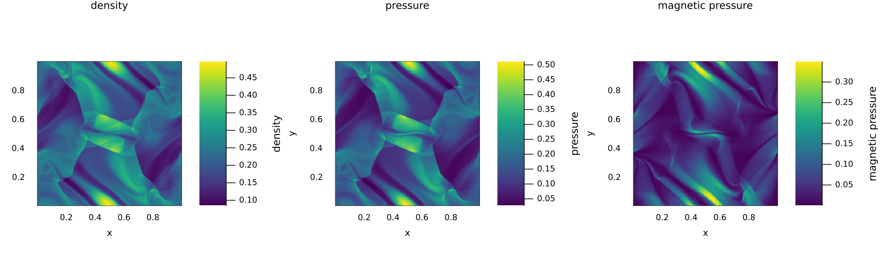

# Magnetohydrodynamics

The MHD module evolves the equations of ideal MHD with constrained transport, so that the discrete divergence of the magnetic field stays at round-off. It is Quokka's scheme (Kriel et al., in preparation): the HLLD Riemann solver, the Q26 EMF and the averaging of Londrillo & Del Zanna (2004), in one, two or three dimensions. The functions and types are documented on the reference page [Magnetohydrodynamics](reference/mhd.qmd), and the Riemann solvers on [Hydrodynamics](reference/hydro.qmd).

## 1. Governing equations

$$\begin{aligned}
\frac{\partial\rho}{\partial t} + \nabla\cdot(\rho\mathbf u) &= 0 , \\
\frac{\partial(\rho\mathbf u)}{\partial t} + \nabla\cdot(\rho\mathbf u\mathbf u - \mathbf b\mathbf b + p_{\rm tot}\,\mathsf I) &= 0 , \\
\frac{\partial E}{\partial t} + \nabla\cdot\left[(E + p_{\rm tot})\,\mathbf u - (\mathbf u\cdot\mathbf b)\,\mathbf b\right] &= 0 , \\
\frac{\partial\mathbf b}{\partial t} &= \nabla\times\boldsymbol\varepsilon , \qquad \boldsymbol\varepsilon = \mathbf u\times\mathbf b ,
\end{aligned}$$

with $p_{\rm tot} = p + b^2/2$, $E = e + \rho u^2/2 + b^2/2$ and $\nabla\cdot\mathbf b = 0$. The field is in units in which the magnetic pressure is $b^2/2$ ($\mathbf b = \mathbf B/\sqrt{4\pi}$ in Gaussian units). The EMF is $\boldsymbol\varepsilon = \mathbf u\times\mathbf b$, Quokka's sign, the opposite of Ohm's law $\boldsymbol\varepsilon = -\mathbf u\times\mathbf b$ used in the papers; every formula below has that sign. The fast magnetosonic speed along direction $d$ is

$$c_{f,d}^2 = \frac{1}{2\rho}\left[\gamma p + b^2 + \sqrt{(\gamma p + b^2)^2 - 4\gamma p\, b_d^2}\right] .$$

## 2. Numerical method

### 2.1 Staggered mesh

The normal component $b_d$ is stored at the centre of each face normal to $d$, and the EMF $\varepsilon_w$ at the centre of each edge along $w$. A cell's field is the average of its two faces, $b_{d,i} = (b_{d,i-1/2} + b_{d,i+1/2})/2$, and its energy $b^2/2$ is part of $E$.

### 2.2 Fluxes

The fluxes of $\rho$, $\rho\mathbf u$ and $E$ follow the method of lines, as for hydrodynamics. The primitives and the two transverse components of the cell-centred field are reconstructed to the faces (PCM, PLM or PPM); the normal component is the face value. The Riemann problem is solved with HLLD (Miyoshi & Kusano 2005), with the low-Mach total pressure and the carbuncle blending toward HLL of Minoshima & Miyoshi (2021), or with LLF. Each face keeps the bounding speeds $\alpha^\pm \ge 0$ of its Riemann fan.

### 2.3 The EMF

For the edge along $x_2$, with $x_0$ and $x_1$ the other two directions:

1. **Face velocity (Q26).** On each face, $u^* = (\alpha^+ u_L + \alpha^- u_R)/(\alpha^+ + \alpha^-)$ from the reconstructed normal velocities.
2. **To the edge.** $b_0$ and $u_0^*$ of the $x_0$ faces are reconstructed along $x_1$, giving the values below (B) and above (T) the edge; $b_1$ and $u_1^*$ of the $x_1$ faces along $x_0$, giving left (L) and right (R).
3. **Corners.** $\varepsilon_2^{Q} = u_0^{*} b_1 - u_1^{*} b_0$ at each corner $Q \in \{LB, LT, RB, RT\}$.
4. **Averaging (LD04).** With $\alpha^\pm$ at the edge the larger of the two faces that meet there,

$$\varepsilon_2 = \frac{\alpha_0^+\alpha_1^+\varepsilon^{LB} + \alpha_0^-\alpha_1^+\varepsilon^{RB} + \alpha_0^+\alpha_1^-\varepsilon^{LT} + \alpha_0^-\alpha_1^-\varepsilon^{RT}}{(\alpha_0^+ + \alpha_0^-)(\alpha_1^+ + \alpha_1^-)} + \frac{\alpha_1^+\alpha_1^-}{\alpha_1^+ + \alpha_1^-}\left(b_0^T - b_0^B\right) - \frac{\alpha_0^+\alpha_0^-}{\alpha_0^+ + \alpha_0^-}\left(b_1^R - b_1^L\right) .$$

Along one direction LD04 is the HLL flux of the transverse field, so $\mathbf b$ gets HLL-level dissipation from the edge averaging, not HLLD's. HLLD resolves a rotational discontinuity in its flux, but the field smears across one with either solver, in Quokka as here.

Reconstructing $u^*$ across the sweep needs Riemann solves on faces beyond the interior: 1, 2 or 3 rows into the ghost cells for PCM, PLM or PPM, and one ghost cell more for the carbuncle input of the outermost row.

### 2.4 Time integration

Each stage of the strong-stability-preserving Runge-Kutta method updates the cells and the faces together,

$$U \leftarrow a\,U^0 + b\,U + c\,\Delta t\,L(U), \qquad \mathbf b \leftarrow a\,\mathbf b^0 + b\,\mathbf b + c\,\Delta t\,\nabla_h\times\boldsymbol\varepsilon ,$$

with $\nabla_h\times$ the circulation of the edge EMFs around each face. The discrete divergence of a discrete curl is zero, so every stage of every tableau keeps $\nabla\cdot\mathbf b$ where it was. The time step is $\Delta t = C / \max\sum_d (|u_d| + c_{f,d})/\Delta x_d$.

### 2.5 One and two dimensions

Quokka runs MHD in 3D only. Here a direction with one cell carries one face per cell, whose low and high face are the same face, so averages, differences and reconstructions along it return the value itself. Its faces carry $u^* = u_d$ and $\alpha^\pm = 1$, which cancel out of LD04. A 2D run then equals the same problem in a periodic box four cells deep to the bit, and a 1D run to $10^{-15}$.

### 2.6 Boundaries and floors

Periodic boundaries treat face $hi + 1$ as face $lo$. An outflow boundary is Quokka's MHD diode condition for outflowing gas: ghost cells copy the boundary cell and the transverse ghost faces the boundary row, the normal ghost faces are integrated outward so that $\nabla\cdot\mathbf b = 0$ in every ghost cell, and each ghost cell's total energy is corrected by the difference of its magnetic energy and its source's, so that it has the source's pressure. A static equilibrium then stays at rest up to the boundary.

The total energy contains $b^2/2$, so where $b^2 \gg p$ the internal energy is a small difference of large numbers. A cell floored to the minimum pressure is given the smallest total energy whose internal energy, computed as the conversion to primitives computes it, is above the floor.

### 2.7 Radiation and chemistry

The matter-radiation coupling and the chemistry change the internal energy $e = E - \rho u^2/2 - b^2/2$ and leave the field alone: every solve subtracts the magnetic energy from $E$ before it starts and adds it back after.

## 3. Test problems

The figures and the numbers in the tables are made by `julia --project=. -t auto docs/make_figures.jl mhd`, about half a minute on 8 threads.

### 3.1 Brio-Wu shock tube

A Riemann problem with every MHD wave but the rotational one, compared against Quokka run with the same scheme and the same time step.

| Setup | |
|:---|:---|
| Physics | MHD, HLLD, $\gamma = 2$ |
| Domain | $[0, 1]$, 256 cells (Quokka: a $256\times16\times16$ box periodic across) |
| Initial condition | $(\rho, p, b_y) = (1, 1, 1)$ for $x < 0.5$ and $(0.125, 0.1, -1)$ for $x > 0.5$, at rest, $b_x = 0.75$ |
| Boundary conditions | outflow (Quokka: the initial states) |
| Evolution | $t = 0$ to 0.1 in steps of $2.5\times10^{-4}$; SSPRK2; PCM, PLM (Sweby, $\beta = 1.5$, Quokka's default) or PPM |
| Reference | Quokka's `MHDBrioWuShockTube` with `emf_compute_scheme = Quokka2026`, `emf_averaging_scheme = LondrilloDelZanna2004`, `rk_integrator_order = 2`, in `test/data/quokka` |
| Run | [`brio_wu`](reference/problems.qmd#brio_wu)`(n = 256, reconstruction = PLM(Sweby(1.5)), integrator = SSPRK2())` |

| $L_1$ difference from Quokka | $\rho$ | $u_x$ | $u_y$ | $p$ | $b_y$ |
|:---|---:|---:|---:|---:|---:|
| PCM | $2.4\times10^{-13}$ | $1.8\times10^{-11}$ | $9.9\times10^{-12}$ | $5.8\times10^{-12}$ | $2.8\times10^{-12}$ |
| PLM | $1.9\times10^{-3}$ | $1.7\times10^{-2}$ | $7.5\times10^{-3}$ | $2.3\times10^{-3}$ | $1.9\times10^{-3}$ |
| PPM | $2.8\times10^{-3}$ | $2.7\times10^{-2}$ | $1.6\times10^{-2}$ | $3.6\times10^{-3}$ | $3.1\times10^{-3}$ |

With PCM the two codes run the same scheme and agree to round-off. With PLM and PPM they differ by Quokka's shock flattening, which is always on there and absent here; the PLM limiters are the same.

### 3.2 Ryu-Jones 2a shock tube

All seven MHD waves, with a field out of the plane of the jump.

| Setup | |
|:---|:---|
| Physics | MHD, HLLD, $\gamma = 5/3$ |
| Domain, boundary conditions, reference | as Brio-Wu, with Quokka's `MHDRyuJones2aShockTube`, compared on $x < 0.9$ |
| Initial condition | $(\rho, p, \mathbf u, b_y) = (1.08, 0.95, (1.2, 0.01, 0.5), 3.6/\sqrt{4\pi})$ for $x < 0.5$ and $(1, 1, \mathbf 0, 4/\sqrt{4\pi})$ for $x > 0.5$, $b_x = b_z = 2/\sqrt{4\pi}$ |
| Evolution | as Brio-Wu, to $t = 0.2$ |
| Run | [`ryu_jones_2a`](reference/problems.qmd#ryu_jones_2a)`(n = 256, reconstruction = PLM(Sweby(1.5)), integrator = SSPRK2())` |

| $L_1$ difference, $x < 0.9$ | $\rho$ | $u_x$ | $u_y$ | $u_z$ | $p$ | $b_y$ | $b_z$ |
|:---|---:|---:|---:|---:|---:|---:|---:|
| PCM | $9.0\times10^{-16}$ | $1.1\times10^{-15}$ | $7.6\times10^{-15}$ | $8.0\times10^{-16}$ | $1.1\times10^{-15}$ | $6.8\times10^{-16}$ | $8.6\times10^{-16}$ |
| PLM | $2.7\times10^{-4}$ | $2.3\times10^{-4}$ | $2.1\times10^{-3}$ | $3.1\times10^{-4}$ | $2.4\times10^{-4}$ | $1.4\times10^{-4}$ | $2.7\times10^{-4}$ |
| PPM | $5.7\times10^{-4}$ | $8.1\times10^{-4}$ | $3.2\times10^{-3}$ | $3.6\times10^{-4}$ | $7.2\times10^{-4}$ | $4.7\times10^{-4}$ | $5.5\times10^{-4}$ |

By $t = 0.2$ the fast shock reaches $x = 1$, where the two boundary conditions differ, hence the window.

### 3.3 Circularly polarised Alfven wave

An exact nonlinear solution of ideal MHD (Toth 2000), oblique to the grid, which measures the order of accuracy.

| Setup | |
|:---|:---|
| Physics | MHD, HLLD, $\gamma = 5/3$ |
| Domain | $[0, 2]\times[0, 1]$, $2n \times n$ cells, periodic |
| Initial condition | along $\mathbf k = 2\pi(1/2, 1)$: $\rho = 1$, $p = 0.1$, $b_\parallel = 1$, $u_\parallel = 0$; across it $\mathbf b_\perp = 0.1(\sin\phi, \cos\phi)$, $\mathbf u_\perp = -\mathbf b_\perp$, $\phi = \mathbf k\cdot\mathbf x$; $\mathbf b_\perp$ from a vector potential |
| Evolution | one period, $t = 2/\sqrt5$; SSPRK2 |
| Reference | the initial condition |
| Run | [`alfven_wave`](reference/problems.qmd#alfven_wave)`(n = 64, reconstruction = PLM(Sweby(1.5)), integrator = SSPRK2())` |

| $n$ | PLM | order | PPM | order |
|---:|---:|---:|---:|---:|
| 16 | $7.27\times10^{-2}$ | | $4.71\times10^{-2}$ | |
| 32 | $2.58\times10^{-2}$ | 1.49 | $1.23\times10^{-2}$ | 1.94 |
| 64 | $7.05\times10^{-3}$ | 1.87 | $3.20\times10^{-3}$ | 1.94 |
| 128 | $1.77\times10^{-3}$ | 2.00 | $8.24\times10^{-4}$ | 1.96 |

Both converge at second order, the order of SSPRK2.

### 3.4 Orszag-Tang vortex

Interacting MHD shocks in 2D; the test of robustness and of $\nabla\cdot\mathbf b$.

| Setup | |
|:---|:---|
| Physics | MHD, HLLD, $\gamma = 5/3$ |
| Domain | $[0, 1]^2$, $256^2$ cells, periodic |
| Initial condition | $\rho = 25/(36\pi)$, $p = 5/(12\pi)$, $\mathbf u = (-\sin 2\pi y, \sin 2\pi x)$, $\mathbf b = (-\sin 2\pi y, \sin 4\pi x)/\sqrt{4\pi}$ |
| Evolution | $t = 0$ to 0.5; SSPRK2; PPM; Courant number 0.4 |
| Reference | none; Quokka's `OrszagTang` is the same vortex shifted by half the box |
| Run | [`orszag_tang`](reference/problems.qmd#orszag_tang)`(n = 256, integrator = SSPRK2())` |

| steps | $\max\lvert\nabla\cdot\mathbf b\rvert\,\Delta x/\max\lvert\mathbf b\rvert$ | mass drift | energy drift | floor repairs |
|---:|---:|---:|---:|---:|
| 1440 | $1.5\times10^{-14}$ | $2.3\times10^{-13}$ | $1.9\times10^{-14}$ | 0 |

## 4. Verification

The unit tests check properties rather than tuned numbers:

- $\nabla\cdot\mathbf b$ below $10^{-13}$ after many steps, with both solvers and every reconstruction and tableau, in 2D and in 3D;
- conservation of mass, momentum and energy on a periodic box, and a uniform oblique state preserved;
- periodic face images that stay equal to the bit, and the same shock tube along $x$, $y$ and $z$;
- 1D and 2D runs equal to thin periodic 3D boxes, and periodic face images that stay equal to the bit with noisy 2D data, which pins how far into the ghost cells the Riemann solves reach;
- a static current-free field at rest in an outflow box, and an Orszag-Tang run at plasma $\beta \approx 0.3$ that needs the floors;
- HLLD's flux exact at a stationary contact and a rotational discontinuity, a contact that stays sharp with HLLD and smears with LLF, and LD04 equal to the HLL flux of $b_t$ in 1D;
- radiation and chemistry steps in a magnetised cell that give the internal energy of the same run without a field;
- a checkpoint, which holds the face-centred field as well as the cells, from which a run continues to the bit;
- the comparisons with Quokka and the convergence of section 3, and a 2D comparison: Quokka's `OrszagTang` with PCM for 40 steps, which this code reproduces to $2\times10^{-15}$ (with PPM they differ by $2\times10^{-3}$; the PPM kernels are the same, and Quokka's flattening, whose shock detector can fire at pressure extrema at this resolution, is the likely cause, not isolated).

## 5. Limitations

- **One EMF scheme.** Q26 with LD04; not Quokka's B25b averaging or FS18 and B25a EMFs, and no EMF consistent with HLLD (UCT-HLLD, Mignone & Del Zanna 2021), so rotational discontinuities smear (section 2.3).
- **No first-order flux correction and no shock flattening,** both of which Quokka has.
- **No dual energy.** The internal energy is $E - \rho u^2/2 - b^2/2$, accurate only to the round-off of $b^2/2$ at low plasma $\beta$ (Quokka evolves it separately as well).
- **Boundaries:** periodic and outflow (Quokka's diode condition for outflowing gas, applied whatever the direction of the flow) only.
- **No resistivity, AMR or tiling;** the MHD sweep runs on the CPU only.

## References

- Brio, M. & Wu, C. C. 1988, J. Comput. Phys., 75, 400.
- Felker, K. G. & Stone, J. M. 2018, J. Comput. Phys., 375, 1365.
- Gardiner, T. A. & Stone, J. M. 2005, J. Comput. Phys., 205, 509.
- Kriel, N., et al., in preparation (Quokka's MHD module).
- Londrillo, P. & Del Zanna, L. 2004, J. Comput. Phys., 195, 17.
- Mignone, A. & Del Zanna, L. 2021, J. Comput. Phys., 424, 109748.
- Minoshima, T. & Miyoshi, T. 2021, J. Comput. Phys., 446, 110639.
- Miyoshi, T. & Kusano, K. 2005, J. Comput. Phys., 208, 315.
- Orszag, S. A. & Tang, C.-M. 1979, J. Fluid Mech., 90, 129.
- Ryu, D. & Jones, T. W. 1995, ApJ, 442, 228.
- Toth, G. 2000, J. Comput. Phys., 161, 605.
- Quokka, `src/hydro/mhd_system.hpp`, `src/hydro/HLLD.hpp` and `src/hydro/LLF_mhd.hpp`.
