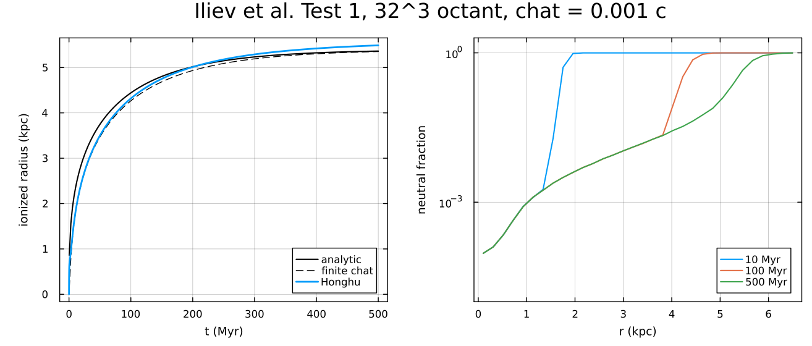
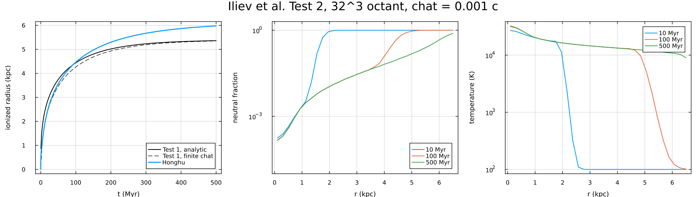

# Photochemistry

The photochemistry module evolves the ionization state and temperature of hydrogen gas lit by ionizing photons. It follows the ATON scheme of Aubert & Teyssier (2008) in the on-the-spot approximation, as Quokka's photoionization module does, and its benchmark is the Stromgren-sphere comparison of Iliev et al. (2006). This page gives the equations and the numerical method. The functions and types are documented on the reference page [Photoionization chemistry](reference/chemistry.qmd), and the cost and accuracy are measured in [the findings note](photoionization-findings.md).

## 1. Governing equations

### 1.1 Gas and species

The gas obeys the Euler equations with a heating $\mathcal H$ and a cooling $\Lambda$, and carries the mass density $\rho X_s$ of each species $s$:

$$\begin{aligned}
\frac{\partial\rho}{\partial t} + \nabla\cdot(\rho\mathbf v) &= 0 , \\
\frac{\partial(\rho\mathbf v)}{\partial t} + \nabla\cdot(\rho\mathbf v\mathbf v + p\,\mathsf I) &= 0 , \\
\frac{\partial E}{\partial t} + \nabla\cdot\left[(E + p)\,\mathbf v\right] &= \mathcal H - \Lambda , \\
\frac{\partial(\rho X_s)}{\partial t} + \nabla\cdot(\rho X_s\mathbf v) &= m_s\,\mathcal R_s ,
\end{aligned}$$

with $E = e + \rho v^2/2$, $e$ the internal energy density, $m_s$ the particle mass and $\mathcal R_s$ the net creation rate of species $s$ per unit volume. The species are H$^0$, H$^+$ and electrons, so $n_s = \rho X_s/m_s$ and $\sum_s n_s m_s = \rho$. Every reaction conserves charge, so $n_e = n_{\rm H^+}$. The radiation exerts no force on the gas.

The gas is monatomic, $p = (\gamma - 1)\,e$ with $\gamma = 5/3$, and its temperature counts every particle:

$$e = \frac32\,k_B\,(n_{\rm H^0} + n_{\rm H^+} + n_e)\,T .$$

At fixed $e$, ionizing the gas halves its temperature.

### 1.2 Ionizing photons

The photon number density $N_\gamma$ and flux $\mathbf F_\gamma$ of the ionizing band obey the first two moments of the transfer equation:

$$\begin{aligned}
\frac{\partial N_\gamma}{\partial t} + \phi\,\nabla\cdot\mathbf F_\gamma &= \phi\,\dot N_\gamma - \hat c\,\sigma\,n_{\rm H^0} N_\gamma , \\
\frac{\partial \mathbf F_\gamma}{\partial t} + \hat c\,c\,\nabla\cdot\mathsf P_\gamma &= -\hat c\,\sigma\,n_{\rm H^0}\,\mathbf F_\gamma .
\end{aligned}$$

| Symbol | Definition |
|:---|:---|
| $N_\gamma$, $\mathbf F_\gamma$ | photon number density (cm$^{-3}$) and number flux (cm$^{-2}$ s$^{-1}$) |
| $\mathsf P_\gamma = \mathsf D\,N_\gamma$ | photon pressure tensor, with $\mathsf D$ the Eddington tensor of the M1 closure (Levermore 1984) |
| $\sigma$ | photoionization cross-section, averaged over the band (cm$^2$) |
| $\dot N_\gamma$ | photons emitted by sources (cm$^{-3}$ s$^{-1}$) |
| $\hat c = \phi\,c$ | the reduced speed of light (section 1.6); $\phi = 1$ gives the physical equations |

The band is one frequency group of the M1 radiation, with energy density $E_\gamma = \varepsilon N_\gamma$. Two numbers stand for its spectrum: $\sigma$ and the mean photon energy $\varepsilon$. Iliev's Test 1 is monochromatic at 13.6 eV, with $\sigma = 6.3\times10^{-18}$ cm$^2$. Test 2 is a $10^5$ K blackbody, represented by $\varepsilon = 29.65$ eV and $\sigma = 1.63\times10^{-18}$ cm$^2$, the number-weighted mean photon energy and cross-section. The gas emits no ionizing photons, so the band has no thermal coupling.

### 1.3 Hydrogen chemistry

Photoionization, collisional ionization and recombination give

$$\mathcal R_{\rm H^+} = -\mathcal R_{\rm H^0} = \Gamma\,n_{\rm H^0} + \beta\,n_e n_{\rm H^0} - \alpha_B\,n_e n_{\rm H^+} ,$$

with $\Gamma = c\,\sigma\,N_\gamma$ the photoionization rate per atom and, in CGS units,

| Process | Coefficient (cm$^3$ s$^{-1}$) | Source |
|:---|:---|:---|
| Case B recombination | $\alpha_B = 2.63\times10^{-13}\,(T/10^4\,{\rm K})^{-0.7}$ | Quokka |
| Collisional ionization | $\beta = 5.84\times10^{-11}\,\sqrt{T}\,e^{-\chi_{\rm H}/k_B T}$ | Krumholz et al. (2007) |

with $\chi_{\rm H} = 13.6$ eV. Iliev's Test 1 uses a constant $\alpha_B = 2.59\times10^{-13}$ cm$^3$ s$^{-1}$.

### 1.4 Heating and cooling

Each photoionization deposits a heating energy $\varepsilon_{\rm heat}$, so $\mathcal H = \varepsilon_{\rm heat}\,\Gamma\,n_{\rm H^0}$. The cooling is

$$\Lambda = \chi_{\rm H}\,\beta\,n_e n_{\rm H^0} + (\Lambda_{\rm rec} + \Lambda_{\rm ff})\,n_e n_{\rm H^+} + \Lambda_{\rm ce}\,n_e n_{\rm H^0} ,$$

| Process | Coefficient (erg cm$^3$ s$^{-1}$) | Source |
|:---|:---|:---|
| Collisional ionization | $\chi_{\rm H}\,\beta$ | |
| Recombination | $\Lambda_{\rm rec} = 6.1\times10^{-10}\,k_B\,T^{0.11}$ for $T \geq 100$ K, zero below | Krumholz et al. (2007) |
| Free-free | $\Lambda_{\rm ff} = 1.3\times1.427\times10^{-27}\,\sqrt T$ | Quokka |
| Ly$\alpha$ excitation | $\Lambda_{\rm ce} = 7.5\times10^{-19}\,e^{-118348\,{\rm K}/T}/(1 + \sqrt{T/10^5\,{\rm K}})$ | Cen (1992); Katz et al. (1996) |

These are Quokka's processes for hydrogen, without its metal-line and neutral-ISM terms, plus the Ly$\alpha$ cooling.

Test 2 uses $\varepsilon_{\rm heat} = \varepsilon - \chi_{\rm H}$ (16.05 eV, as in Quokka), which is too large for a broad spectrum. Because $\sigma$ falls steeply with frequency, the low-energy photons do most of the ionizing, and the optically thin value is $\langle\varepsilon\rangle\,\sigma_E/\sigma_N - \chi_{\rm H} \approx 6.3$ eV for a $10^5$ K blackbody. One band cannot get both the ionization and the heating right. The effect on Test 2 is small: the ionized gas is about 10% hotter ([findings, section 4](photoionization-findings.md#the-overheating-of-test-2)).

For Iliev's Test 1 the energy equation is replaced by a fixed temperature, $T = 10^4$ K.

### 1.5 The on-the-spot approximation

A recombination to the ground state emits an ionizing photon. In the on-the-spot approximation that photon is absorbed nearby, so the two events cancel: the recombination coefficient is the case B one, and the diffuse recombination radiation, $n_e n_{\rm H^+}(\alpha_A - \alpha_B)$ in Quokka's note, is dropped. This is good deep inside an H II region and poor near the front and in diffuse ionized gas.

### 1.6 The reduced speed of light

Light crosses an H II region in about $10^4$ years while the region evolves over hundreds of Myr. The reduced speed of light approximation (RSLA; Gnedin & Abel 2001) transports the photons at $\hat c = \phi\,c$, which lengthens the transport step by $1/\phi$. In the equations of section 1.2, $\phi$ multiplies the time derivative of the radiation and nothing on the gas side, so:

- **steady states are physical:** where $\partial_t = 0$, $\phi$ drops out, and the ionization equilibrium does not depend on $\hat c$;
- **the band loses photons at $\hat c\,\sigma n_{\rm H^0} N_\gamma$, the gas ionizes at $c\,\sigma n_{\rm H^0} N_\gamma$,** and sources add $\phi\,\dot N_\gamma$;
- **the photon budget $n_{\rm H^+} + N_\gamma/\phi$ is conserved.**

Quokka writes the same scheme in $N_Q = N_\gamma/\phi$, with unscaled sources and $\hat c$ in both rates.

The RSLA is accurate when $\hat c$ exceeds the speed of the ionization front (section 1.8). Early on the front is faster than any affordable $\hat c$ and is held back by it ([findings, section 3](photoionization-findings.md#the-reduced-speed-of-light-on-test-1)).

### 1.7 Conservation laws

The chemistry conserves hydrogen nuclei and charge. With photoionization alone and $\varepsilon_{\rm heat} = \varepsilon - \chi_{\rm H}$, the local equations also conserve the photon budget and the energy,

$$n_{\rm H^+} + \frac{N_\gamma}{\phi} , \qquad e + \chi_{\rm H}\,n_{\rm H^+} + \varepsilon\,\frac{N_\gamma}{\phi} ,$$

each photon's energy going to the ionization potential and to heat. Both are linear in the unknowns, so the integrators preserve them to round-off, which makes them exact tests.

### 1.8 A reference solution: the H II region

A source of $\dot N$ ionizing photons per second in uniform hydrogen ionizes a sphere that stops growing when recombinations inside it use up all the photons, at the Stromgren radius

$$r_S = \left(\frac{3\dot N}{4\pi\,\alpha_B\,n_{\rm H}^2}\right)^{1/3} .$$

For a sharp front and an infinite speed of light, the radius and speed of the front are

$$r_I = r_S\left(1 - e^{-t/t_{\rm rec}}\right)^{1/3} , \qquad v_I = \frac{r_S}{3t_{\rm rec}}\,e^{-t/t_{\rm rec}}\left(1 - e^{-t/t_{\rm rec}}\right)^{-2/3} , \qquad t_{\rm rec} = \frac{1}{\alpha_B\,n_{\rm H}} .$$

For Iliev's Test 1 ($\dot N = 5\times10^{48}$ s$^{-1}$, $n_{\rm H} = 10^{-3}$ cm$^{-3}$), $r_S = 5.39$ kpc and $t_{\rm rec} = 122.3$ Myr, and the front moves at about 70, 30 and 9 km s$^{-1}$ at 10, 30 and 100 Myr. At a finite $\hat c$, Shapiro et al. (2006) add the photons in flight to the budget:

$$\frac{dR}{dt} = \frac{\dot N - \tfrac{4\pi}{3}R^3\alpha_B n_{\rm H}^2}{\dot N/\hat c + 4\pi R^2 n_{\rm H}} .$$

This is approximate, since it ignores recombinations among the photons in flight. Both solutions are in `Honghu.Problems` ([`stromgren_radius_analytic`](reference/problems.qmd#stromgren_radius_analytic), [`stromgren_radius_finite_c`](reference/problems.qmd#stromgren_radius_finite_c)), with the Iliev tests ([`stromgren_iliev`](reference/problems.qmd#stromgren_iliev)).

## 2. Numerical method

### 2.1 Operator splitting

The equations split into hydrodynamics $\mathcal H$ (with the advection of the species), radiation transport $\mathcal T$, and the local source terms $\mathcal C$ (chemistry, heating and cooling, absorption and emission). One step is

$$U^{n+1} = \Big[\mathcal C_{\Delta t_r}\,\mathcal T_{\Delta t_r}\Big]^{n_{\rm sub}}\,\mathcal H_{\Delta t}\,U^n , \qquad \Delta t_r = \Delta t/n_{\rm sub} ,$$

where the radiation subcycles because its Courant step, $\Delta t_r \propto \Delta x/\hat c$, is much shorter than the hydrodynamic one. Within a substep the photons are transported first and the chemistry then acts over the whole substep, as in ATON and Quokka. The transport operators are those of Honghu's hydrodynamics and radiation transport. This Lie splitting is first order in time.

The emission enters $\mathcal C$ as photons added at the start of the substep. In an opaque cell the gas then ionizes early and recombines for the rest of the substep, which biases the ionization equilibrium low by about $\alpha_B n_{\rm H} x^2\Delta t_r/2$, with $x = n_{\rm H^+}/n_{\rm H}$. In a uniform test with $x = 0.5$ exact, this gave 0.4939 at $\Delta t_r = 0.05\,t_{\rm rec}$ and 0.4450 at $0.5\,t_{\rm rec}$ ([findings, section 5](photoionization-findings.md#two-choices-in-the-scheme-that-the-results-depend-on)). Strang-split or in-ODE emission would remove the bias; neither is implemented. Since $\Delta t_r \propto 1/\hat c$, a smaller $\hat c$ makes the bias larger and the local problem stiffer.

### 2.2 Advection of the species

The flux of each species is the mass flux from the hydrodynamic Riemann solver times the upwind mass fraction:

$$F_{\rho X_s} = F_\rho\,X_s^{\rm upwind} , \qquad X_s^{\rm upwind} = \frac{(\rho X_s)_{\rm face}}{\rho_{\rm face}}\ \text{on the upwind side} .$$

A uniform $X_s$ is then advected exactly. For HLLC this equals Quokka's flux; for local Lax-Friedrichs it is less diffusive. Because each $\rho X_s$ is reconstructed and limited separately, the species fluxes do not add up to the mass flux, and $\sum_s X_s$ drifts from one at second and third order. The species are therefore rescaled to $\sum_s \rho X_s = \rho$ in every cell, at every Runge-Kutta stage and before the chemistry, as Quokka does. This conserves total mass but not each species. Consistent multi-fluid advection (CMA; Plewa & Müller 1999) would conserve each species, and is not implemented.

### 2.3 The local problem: an error-controlled Rosenbrock integrator

In each cell, $\mathcal C$ integrates the stiff system

$$\frac{\mathrm du}{\mathrm dt} = S(u) , \qquad u = (n_{\rm H^0},\, n_{\rm H^+},\, n_e,\, e,\, N,\, f) ,$$

with $S$ the source terms of sections 1.1–1.4 and the photon loss. The photons are stored as $N = N_\gamma/\phi$, Quokka's $N_Q$, so that both rates read $\hat c N$: the gas ionizes at $\hat c\,\sigma n_{\rm H^0} N = c\,\sigma n_{\rm H^0} N_\gamma$, and $N$ loses the same number. The last unknown, $f$, is the factor by which absorption has attenuated the band's flux, $\mathrm df/\mathrm dt = -\hat c\,\sigma\,n_{\rm H^0} f$ from $f = 1$. Every flux component obeys this linear equation, so one factor carries all three; without emission inside $S$ it equals $N^{\rm end}/N^{\rm start}$, Quokka's `SKIP_PHOTOCHEMFLUX`.

The default integrator is `Rosenbrock23` from OrdinaryDiffEq, the method of MATLAB's `ode23s` (Shampine & Reichelt 1997): a linearly implicit, second-order Rosenbrock-W method with an embedded third-order error estimate. Each internal step solves linear systems with $I - \gamma h J$, $J = \partial S/\partial u$, instead of iterating Newton's method, and the step size is adapted to keep the error estimate below $a_i + r\,|u_i|$ for each unknown. So each cell takes the internal steps it needs, and the error is controlled rather than assumed.

The relative tolerance is $r = 10^{-2}$. The absolute tolerances are $10^{-8}$ of a physical scale of each unknown: the total particle density for the species and for $N$ (one photon per particle in the budget of section 1.6), the cell's internal energy for $e$, and 1 for $f$. A tolerance then means the same in every cell and unit system. The Jacobian is exact and analytic, including the temperature dependence of every rate. Negative densities enter the rates as zero, so a trial state slightly below zero cannot create atoms. On the Iliev tests this takes about 15 internal steps and 5–6.5 µs per cell per substep, with no failures ([findings, section 1](photoionization-findings.md#cost-of-the-chemistry-step)).

### 2.4 The alternative: one backward-Euler step

The local problem can also be solved in one backward-Euler step over the substep, the root of $G(u) = u - u^n - \Delta t_r\,S(u)$, by Newton's method with a backtracking line search, keeping the densities non-negative. It is first order and costs about 0.1 µs per cell, 45 to 100 times less than the Rosenbrock integrator.

Newton can fail on this equation:

- in a stiff growth term, such as collisional ionization with $\beta\,n_{\rm H^0}\,\Delta t_r > 1$, where the Newton direction points into the zero bound;
- in very stiff photoionization, $\Gamma\,\Delta t_r \sim 10^2$–$10^3$;
- across a discontinuous rate, such as the 100 K switch of the recombination cooling.

It failed in 10% of a 2592-cell stress grid and nowhere in the Iliev tests. On Test 2 it matches the Rosenbrock radius to 0.1%, and the front temperature to within 29% ([findings, section 2](photoionization-findings.md#the-two-integrators-on-test-2)). Failed cells are always reported.

## 3. Design

The local problem is defined once, by a *network* ([`AbstractNetwork`](reference/chemistry.qmd#AbstractNetwork)): species, bands, $S(u)$ and its exact Jacobian. It is solved by an *integrator* ([`AbstractChemSolver`](reference/chemistry.qmd#AbstractChemSolver)) that reads only those. The two integrators thus solve exactly the same problem, and a new network or a new integrator can be added without touching the other. What is not a term of the local ODE (the emission, applying the flux factor, keeping the stored state admissible) is done around the solve, not in $S$.

### 3.1 Networks from JAFF

Networks are not written by hand. They are generated by [JAFF](https://github.com/jaff-chemistry/jaff), the network tool that also writes Quokka's, with its `honghu` template. A network is two files in a folder of `networks/`:

- `name.jet`, the reactions with their rate coefficients, one per line; a photoreaction is marked `PHOTO` with its threshold in eV;
- `name.jet.jfunc`, the rest of the physics as functions of `tgas` and the species densities: the cross-section of each photoreaction (`photoCrossSection<N>`), the energy each reaction gives the gas (`deltaE<N>`), custom rates (`chemRate<N>`) and the cooling (`heatingCoolingRate`);

and a `jaffgen.toml` that names the network and sets its radiation bands. JAFF writes $S(u)$ and its Jacobian from these, symbolically, and `networks/regenerate.sh --jaff-path DIR` writes them into `src/networks/` as Julia. Honghu adds the parts common to every network: the temperature, the isothermal option, the temperature floor, and the scales of the tolerance. The built-in networks are [`HydrogenIliev1`](reference/chemistry.qmd#HydrogenIliev1) and [`HydrogenIliev2`](reference/chemistry.qmd#HydrogenIliev2), for the two tests below. The mean photon energy of a band is not part of a network; it is given when the network is built ([`NetworkOptions`](reference/chemistry.qmd#NetworkOptions)), and the heating per ionization in the `.jfunc` must agree with it.

## 4. Test problems

Both tests are from Iliev et al. (2006): an ionizing source switched on in uniform, static, neutral hydrogen. The figures and the numbers in the tables are made by `julia --project=. -t auto docs/make_figures.jl stromgren`, which takes about 9 minutes on 8 threads.

### 4.1 Iliev Test 1: isothermal H II region

The front radius has an analytic solution (section 1.8), so this test measures the accuracy of the transport, the chemistry and the reduced speed of light together.

| Setup | |
|:---|:---|
| Physics | radiation transport (M1, one ionizing band); photochemistry ([`HydrogenIliev1`](reference/chemistry.qmd#HydrogenIliev1)), isothermal at $10^4$ K, $\alpha_B = 2.59\times10^{-13}$ cm$^3$ s$^{-1}$, no collisional ionization; hydrodynamics off |
| Domain | the octant $[0, 6.6\ {\rm kpc}]^3$ with the source at the origin, $32^3$ cells ($\Delta x = 206$ pc) |
| Initial condition | $n_{\rm H} = 10^{-3}$ cm$^{-3}$, $T = 10^4$ K, $x = 1.2\times10^{-3}$, $N_\gamma = 0$, $\mathbf F_\gamma = 0$ |
| Boundary conditions | reflecting on the three faces through the source, outflow on the other three |
| Source | $\dot N = 5\times10^{48}$ s$^{-1}$ ($\dot N/8$ into the octant), monochromatic at 13.6 eV with $\sigma = 6.3\times10^{-18}$ cm$^2$, spread over a Gaussian of width $1.5\,\Delta x$ |
| Evolution | $t = 0$ to 500 Myr; $\hat c = 10^{-3}c$; radiation Courant number 0.3; `RosenbrockChem`, relative tolerance $10^{-2}$ |
| Reference | $r_I(t)$ for $\hat c = c$, and the finite-$\hat c$ front of Shapiro et al. (2006) |
| Run | [`stromgren_iliev`](reference/problems.qmd#stromgren_iliev)`(test = 1, n = 32, chat_factor = 1e-3)` |

| $t$ (Myr) | $r_I$ (kpc) | finite $\hat c$ (kpc) | error | $\hat c = c$ (kpc) | error |
|---:|---:|---:|---:|---:|---:|
| 10 | 1.769 | 1.749 | +1.2% | 2.309 | −23.4% |
| 30 | 2.903 | 2.880 | +0.8% | 3.243 | −10.5% |
| 100 | 4.318 | 4.266 | +1.2% | 4.441 | −2.8% |
| 200 | 5.011 | 4.934 | +1.6% | 5.017 | −0.1% |
| 500 | 5.489 | 5.352 | +2.6% | 5.363 | +2.3% |

The front follows the finite-$\hat c$ solution to within 2.6% at all times. Early on it lags the $\hat c = c$ curve, because many of the photons are still in flight at $\hat c$, and it catches up as the front slows. The excess of about 2.5% at late times does not depend on $\hat c$ ([findings, section 3](photoionization-findings.md#the-reduced-speed-of-light-on-test-1)). The run had no failed chemistry solves.

### 4.2 Iliev Test 2: H II region with heating and cooling

The gas starts cold and is heated by the photoionizations. There is no analytic solution, and the result is checked for its shape.

| Setup | |
|:---|:---|
| Physics | as Test 1, but the network [`HydrogenIliev2`](reference/chemistry.qmd#HydrogenIliev2), with the energy equation: photoheating and cooling (section 1.4), $\alpha_B(T)$ and collisional ionization |
| Domain, boundary conditions, evolution | as Test 1 |
| Initial condition | as Test 1, but $T = 100$ K and $x = 0$ |
| Source | as Test 1, but a $10^5$ K blackbody as one band: $\varepsilon = 29.65$ eV, $\sigma = 1.63\times10^{-18}$ cm$^2$, $\varepsilon_{\rm heat} = 16.05$ eV |
| Reference | none; the Test 1 solutions are shown for scale |
| Run | [`stromgren_iliev`](reference/problems.qmd#stromgren_iliev)`(test = 2, n = 32, chat_factor = 1e-3)` |

| $t$ (Myr) | 10 | 30 | 100 | 200 | 500 |
|:---|---:|---:|---:|---:|---:|
| $r_I$ (kpc) | 1.764 | 2.938 | 4.468 | 5.296 | 5.978 |
| median $T$ where $x > 0.9$ (K) | 19100 | 16200 | 14300 | 13700 | 13700 |

The ionized gas is heated to about $1.4\times10^4$ K and the neutral gas ahead of the front stays at 100 K. Hot gas recombines more slowly ($\alpha_B \propto T^{-0.7}$), so the front ends about 11% beyond the Test 1 radius. By 500 Myr it reaches the outer faces of the box, so the last radius is a lower bound. The single band overheats the ionized gas by about 10% (section 1.4), so these temperatures are not those of a full spectrum. The run had no failed chemistry solves.

## 5. Verification

The unit tests check properties rather than tuned numbers:

- the generated Jacobians against a 256-bit finite difference, including the isothermal and floored cases, and the generated rates against hand-computed values;
- the photon budget, charge and the energy of section 1.7, with a photoionization-only network generated for the tests, to $10^{-10}$ in a cell and $10^{-8}$ in a whole run;
- the ionization equilibrium, and that it does not depend on $\hat c$;
- conservation of hydrogen and $\sum_s X_s = 1$ in moving gas;
- Iliev's Test 1 at $16^3$, within 4.5% of the finite-$\hat c$ solution, and Test 2, a growing front with hot gas behind it and cold gas ahead.

## 6. Limitations

- **Hydrogen only, one band, on the spot.** JAFF can write networks with more species and bands, but the emission goes into the first band only, and diffuse recombination radiation is not followed.
- **What JAFF does not know is set by hand:** the mean photon energy of each band, and so the heating per ionization in the `.jfunc`. JAFF averages a flat cross-section over a band that extends to infinity to only $2\times10^{-8}$.
- **No radiation pressure** (`beta_order = 0`).
- **No thermal radiation groups alongside.** The thermal coupling uses a constant mean molecular weight, which is wrong by up to a factor of 2 in ionized gas, so groups with thermal opacity are refused.
- **A constant reduced speed of light,** a monatomic gas ($\gamma = 5/3$) and CGS units.
- **First-order splitting** (section 2.1), and a species renormalisation that does not conserve each species (section 2.2).
- **One band cannot get the heating right** for a broad spectrum (section 1.4).
- **The front is not quite round** at low resolution, and part of its offset from the finite-$\hat c$ solution is unexplained ([findings, section 3](photoionization-findings.md#the-reduced-speed-of-light-on-test-1)).

## References

- Aubert, D. & Teyssier, R. 2008, MNRAS, 387, 295 (ATON).
- Cen, R. 1992, ApJS, 78, 341.
- JAFF, <https://github.com/jaff-chemistry/jaff>.
- Gnedin, N. Y. & Abel, T. 2001, New Astron., 6, 437.
- Iliev, I. T., et al. 2006, MNRAS, 371, 1057.
- Katz, N., Weinberg, D. H. & Hernquist, L. 1996, ApJS, 105, 19.
- Krumholz, M. R., Stone, J. M. & Gardiner, T. A. 2007, ApJ, 671, 518.
- Levermore, C. D. 1984, J. Quant. Spectrosc. Radiat. Transfer, 31, 149.
- Plewa, T. & Müller, E. 1999, A&A, 342, 179.
- Shampine, L. F. & Reichelt, M. W. 1997, SIAM J. Sci. Comput., 18, 1.
- Shapiro, P. R., Iliev, I. T., Alvarez, M. A. & Scannapieco, E. 2006, ApJ, 648, 922.
- Quokka, `docs/markdown/photoionization.md` and `src/networks/photoionization_H_caseB_handwritten/actual_rhs.H`.
