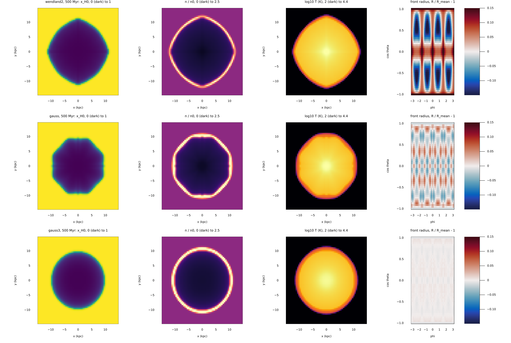
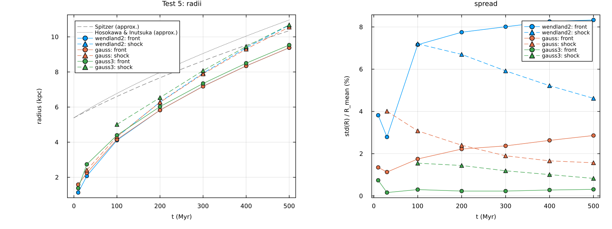
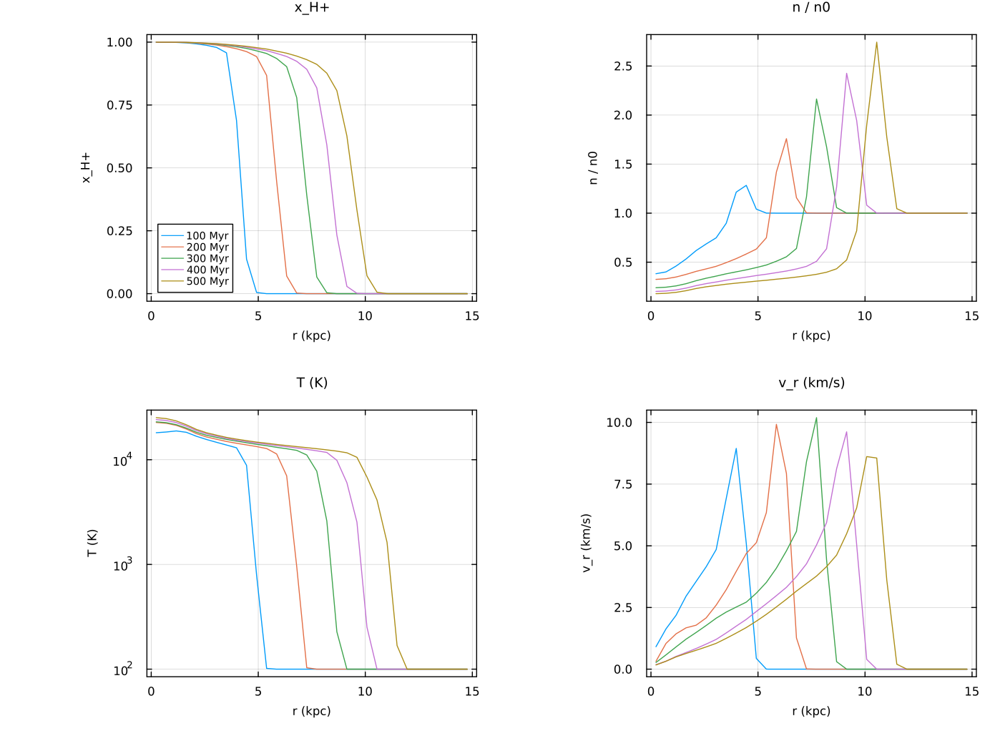

# Sphericity of an expanding HII region (Iliev et al. 2009, Test 5)

**Question.** With hydrodynamics on, does the HII region stay round through the R-type and the D-type phase, and how does the kernel that deposits the source photons change that? This continues `../sphericity/README.md`, which has hydrodynamics off and so only the R-type phase.

**Answer.** The D-type front keeps the shape that the R-type front got from the source, and its spread grows with time. With Quokka's Wendland kernel (`wendland2`) the front becomes a diamond with a spread of 8.3% at 500 Myr; with the default Gaussian (`gauss`) an octagon with 2.9%; with a Gaussian of width $3\,\Delta x$ (`gauss3`) it stays round to 0.3%. The shock ahead of the front is rounder than the front, and its spread falls with time. The mean radii of all three runs agree to 1.6%.

## Setup

- Iliev et al. (2009) Test 5, "classical HII region expansion": hydrogen at $n_{\rm H} = 10^{-3}$ cm$^{-3}$, neutral and at rest at 100 K at the start, $\dot N = 5\times10^{48}$ s$^{-1}$, run to 500 Myr. This is `Honghu.Problems.stromgren_iliev(test = 5)`.
- The whole sphere in a centred box $[-15, 15]^3$ kpc, $64^3$ cells ($\Delta x = 0.469$ kpc), `Outflow` boundaries. The source is at the origin, a cell corner.
- Hydrodynamics on, with the package's default scheme, and an ideal gas with $\gamma = 5/3$. M1 radiation with one group, HLL fluxes, $\hat c = 3\times10^{-4}c$.
- The network is `HydrogenIliev2`, the one of Test 2: one band at 29.65 eV with $\sigma = 1.63\times10^{-18}$ cm$^2$ in place of the paper's $10^5$ K blackbody, and 16.05 eV of heating per ionization, which overheats the ionized gas (1.3 to $2\times10^4$ K here). So the expansion is checked for its shape, not against the paper's curves.
- Chemistry solver `BackwardEulerChem` (see the check with `RosenbrockChem` below).
- The kernels are those of `../sphericity/README.md`, in units of the cell: `wendland2` (Quokka's Wendland C2, support $2\,\Delta x$), `gauss` (the default, Quokka's Gaussian of `testStromgrenSphere.cpp`, $\sigma = 1.5\,\Delta x$ cut at $2.5\sigma$) and `gauss3` ($\sigma = 3\,\Delta x$, cut at $4\sigma$). The cells here are 2.3 times larger than there, so each kernel is 2.3 times larger in kpc.

**The measurement.** At 10, 30, 100, 200, 300, 400 and 500 Myr, along 4000 directions spread evenly over the sphere, the script finds the **front**, the radius where $x_{\rm H^+}$ falls through 0.5, and the **shock**, the radius of the densest point along the ray. Both use trilinear interpolation between the cell centres. The spread is ${\rm std}(R)/\bar R$. The densest point is a shock only once the gas is compressed, so the figure shows the shock only where the largest density is above $1.1\,n_0$ (from 30 Myr on for `gauss`, from 100 Myr on for `wendland2` and `gauss3`).

## Reproduce

From a clone of Honghu.jl, on this branch:

```bash
julia --project=. -e 'using Pkg; Pkg.instantiate()'     # once

# the three runs: about 45 s each on 6 threads of an Apple M5 Max
julia --project=. -t auto docs/photoionization-experiments/dtype.jl wendland2 gauss gauss3

# the figures (needs Plots in the global environment)
julia --project=. docs/photoionization-experiments/dtype_plots.jl wendland2 gauss gauss3

# the solver check: about 9 minutes
julia --project=. -t auto docs/photoionization-experiments/dtype.jl gauss --solver=ros
```

Options: `--n=64`, `--solver=be|ros`, `--outdir=DIR` (default: this folder). Any kernel of `../sphericity.jl` can be named. The run script writes `dtype_<kernel>_<solver>.txt` (radii and spreads against time), `dtype_<kernel>_<solver>_profiles.txt` (shell-averaged $x_{\rm H^+}$, $n/n_0$, $T$ and $v_r$) and the raw fields `x_`, `rho_` and `T_<kernel>_<solver>_<t>Myr.f32` ($n^3$ `Float32`, $x$ fastest, not in git).

## Results

| Kernel | Front spread, 30 Myr | 100 Myr | 500 Myr | Shock spread, 100 Myr | 500 Myr | Front, 500 Myr (kpc) | Shock, 500 Myr (kpc) | $n_{\max}/n_0$, 500 Myr |
|:---|---:|---:|---:|---:|---:|---:|---:|---:|
| `wendland2` (Quokka's) | 2.79% | 7.16% | 8.33% | 7.20% | 4.62% | 9.38 | 10.67 | 3.26 |
| `gauss` (default) | 1.13% | 1.75% | 2.86% | 3.08% | 1.57% | 9.38 | 10.56 | 3.20 |
| `gauss3` | 0.16% | 0.30% | 0.31% | 1.55% | 0.83% | 9.53 | 10.68 | 3.19 |

The front and shock radii are means over the 4000 directions.



*One row per kernel, at 500 Myr. Columns 1 to 3: the mid-plane $z = -\Delta x/2$, the neutral fraction (linear, 0 to 1), $n/n_0$ and $\log_{10} T$, each with its colour range in its title. Column 4: the front radius in all directions, $R/\bar R - 1$, against $\phi$ and $\cos\theta$, on one colour scale for all rows.*



*Left: the mean front (circles) and shock (triangles) radius. The grey curves are approximate D-type references: Spitzer (1978), $R = R_S(1 + 7c_{\rm II}t/4R_S)^{4/7}$, and Hosokawa & Inutsuka (2006), with $c_{\rm II} \to \sqrt{4/3}\,c_{\rm II}$, both with $R_S = 5.39$ kpc and $c_{\rm II} = 12.8$ km s$^{-1}$ (ionized hydrogen at $10^4$ K), starting at $R_S$ at $t = 0$. They have no R-type phase, so they only bracket the late slope. Right: the spread of the front and of the shock.*



*Shell-averaged profiles for `gauss` from 100 to 500 Myr: the ionized region, the dense shell with the shock at its outer edge, the rarefied hot interior, and the outward velocity of about 10 km s$^{-1}$ at the shell.*

The figures `dtype_evolution_<kernel>_be.png` show the four panels of one kernel at 100, 300 and 500 Myr, and `dtype_profiles_<kernel>_be.png` the profiles of the other kernels.

**Solver check.** `gauss` with `RosenbrockChem` gives a front spread of 1.80% at 100 Myr and 2.82% at 500 Myr, and a shock spread of 1.60% at 500 Myr, against 1.75%, 2.86% and 1.57% with `BackwardEulerChem`; the radii agree to 0.2%. It took 535 s against 43 s.

## What this means

1. The D-type phase does not make the HII region round. The front keeps the pattern that it got in the R-type phase from the source: a diamond for `wendland2`, an octagon for `gauss`. Its spread grows during the expansion, from 2.8% to 8.3% for `wendland2` and from 1.1% to 2.9% for `gauss`.
2. The shock is rounder than the front, and becomes rounder with time: for `wendland2` its spread falls from 7.2% at 100 Myr to 4.6% at 500 Myr. So the dense shell is smoother than the ionized region inside it.
3. A wide, smooth source gives a round HII region through both phases: `gauss3` keeps the front within 0.3% and the shock within 1.6%.
4. The kernel changes the shape, not the size. At 500 Myr the mean fronts agree to 1.6% and the mean shocks to 1.1%.
5. The front at 500 Myr is 0.8 to 1.6 kpc inside the two approximate references. They start at $R_S$ at $t = 0$ and ignore the R-type phase, and the gas here is hotter than their $10^4$ K, so this is not a test of the expansion rate.

**For Quokka.** The kernel of `testDTypeFront3D.cpp` is `WendlandC2` with $N = 2$, the `wendland2` of this study. If Quokka transports radiation as Honghu does, a Quokka run with that source should show the same diamond, with the front about 8% aspherical by 500 Myr (not verified in Quokka). A larger support, or a Gaussian of width $3\,\Delta x$, should remove most of it.

## Caveats and what is not known

- One band and overheated gas: the temperature of the ionized gas, hence the pressure and the expansion speed, is not the paper's.
- The cells are large: the Stromgren radius is 11.5 cells. How the spreads change with resolution is not tested.
- The radiation floor was hit in about 94000 of $2.7\times10^8$ cell updates for `gauss` (65000 and 48000 for `wendland2` and `gauss3`), and the gas floors never.
- Why the front spread grows in the D-type phase while the shock spread falls is not examined.
