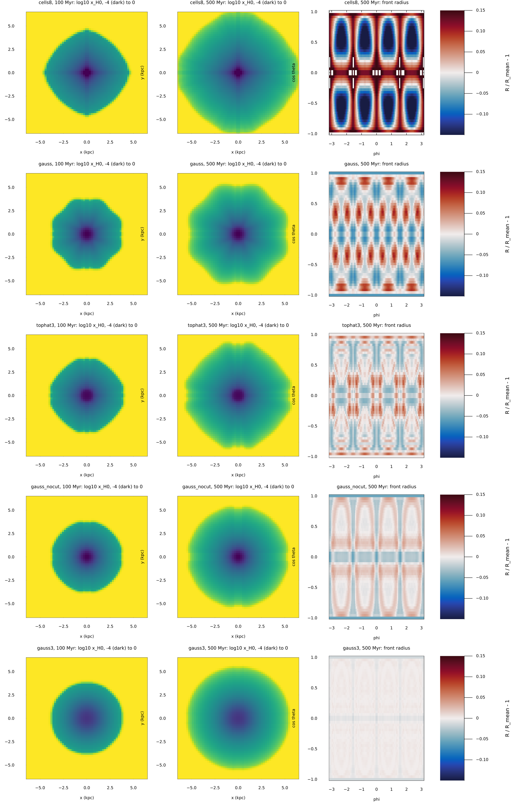
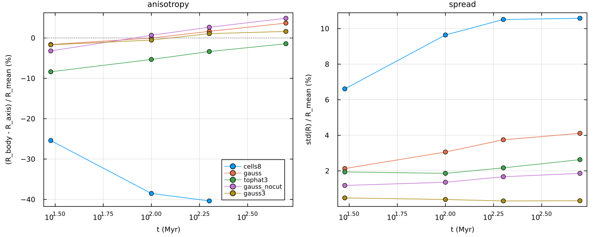
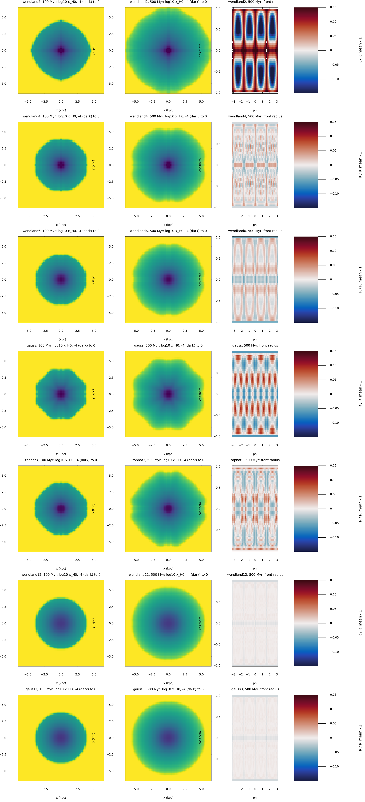
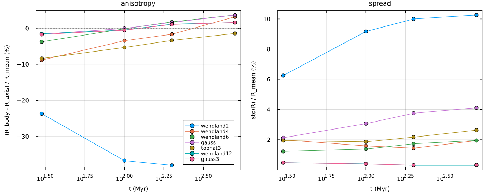

# Sphericity of the Stromgren HII region

**Question.** Is the ionized region of the Stromgren-sphere test smooth and spherical, and does the kernel that deposits the source photons on the grid change its shape?

**Answer.** It depends on the kernel. A compact or sharp-edged source makes an aspherical front with a cubic pattern, of $\pm 10\%$ to $\pm 20\%$ in radius. A Gaussian source of width $3\,\Delta x$ makes a front that is round to 0.3%. The default kernel, which is Quokka's (a Gaussian of width $1.5\,\Delta x$, cut at 2.5 widths), gives eight lobes with a spread of 4%. The Wendland C2 kernel that Quokka deposits particle radiation with (support $2\,\Delta x$) gives an octahedron with a spread of 10%. At the same width, the Wendland and the Gaussian kernels give the same spread: the width matters, not the shape.

**Scope.** These runs have hydrodynamics off, so they test only the radiation transport and the chemistry in the R-type phase. They have no D-type phase.

## Setup

- Iliev et al. (2006) Test 1: hydrogen at $n_{\rm H} = 10^{-3}$ cm$^{-3}$, isothermal at $10^4$ K, $\dot N = 5\times10^{48}$ s$^{-1}$, $\alpha_B = 2.59\times10^{-13}$ cm$^3$ s$^{-1}$. The Stromgren radius is 5.39 kpc.
- The whole sphere in a centred box of side 13.2 kpc, $64^3$ cells ($\Delta x = 0.206$ kpc), `Outflow` boundaries. The source is at the origin, which is a cell corner.
- Hydrodynamics off. M1 radiation with one group, HLL fluxes, $\hat c = 3\times10^{-4}c$. Chemistry solver `BackwardEulerChem` (see the check with `RosenbrockChem` below).
- Every kernel is normalised over the grid, so the cells receive exactly $\dot N$ photons per second in each run. Only the shape of the source changes.

| Kernel | Weight of the cell centred at $\mathbf{r}$ |
|:---|:---|
| `cells8` | 1 in the 8 cells that touch the source, 0 elsewhere |
| `gauss` (default, Quokka's) | $\exp(-r^2/2\sigma^2)$, $\sigma = 1.5\,\Delta x$, zero for $r > 2.5\sigma$ |
| `tophat3` | the volume fraction of the cell inside the sphere $r < 3\,\Delta x$ |
| `gauss_nocut` | as `gauss`, cut at $5\sigma$ instead of $2.5\sigma$ |
| `gauss3` | $\sigma = 3\,\Delta x$, cut at $4\sigma$ |
| `wendland<h>` | Wendland C2, $(1-q)^4(4q+1)$ with $q = r/(h\,\Delta x)$, zero for $q > 1$; $h$ = 2 (Quokka's), 4, 6 and 12 |

The Wendland C2 kernel has a standard deviation per axis of $0.258\,h\,\Delta x$: 0.52, 1.03, 1.55 and 3.1 $\Delta x$ for $h$ = 2, 4, 6 and 12. So `wendland6` has the width of `gauss`, and `wendland12` that of `gauss3`.

**The measurement.** At 30, 100, 200 and 500 Myr, the script finds the radius $R$ where the ionization fraction $x_{\rm H^+}$ falls through 0.5, along 4000 directions spread evenly over the sphere. It interpolates $x_{\rm H^+}$ trilinearly between the cell centres. The **spread** is ${\rm std}(R)/\bar R$. A perfect sphere has a spread of 0.

## Reproduce

From a clone of Honghu.jl, on this branch:

```bash
julia --project=. -e 'using Pkg; Pkg.instantiate()'     # once

# the five runs: about 80 s each on 6 threads of an Apple M5 Max
julia --project=. -t auto docs/photoionization-experiments/sphericity.jl cells8 gauss tophat3 gauss_nocut gauss3

# the figures (needs Plots in the global environment)
julia --project=. docs/photoionization-experiments/sphericity_plots.jl cells8 gauss tophat3 gauss_nocut gauss3

# the Wendland kernels, and their figures against the Gaussians and the top hat
julia --project=. -t auto docs/photoionization-experiments/sphericity.jl wendland2 wendland4 wendland6 wendland12
julia --project=. docs/photoionization-experiments/sphericity_plots.jl wendland2 wendland4 wendland6 gauss tophat3 wendland12 gauss3 --fig=wendland
```

Options of both scripts: `--n=64` (cells per side), `--solver=be` or `--solver=ros` (`BackwardEulerChem` or `RosenbrockChem`), `--outdir=DIR` (default: this folder). The plot script also takes `--fig=TAG`, which names its two summary figures `sphericity_comparison_TAG_<solver>.png` and `sphericity_summary_TAG_<solver>.png`. With no kernel names, the run script runs all of them.

The run script writes one table per kernel, `sphericity_<kernel>_<solver>.txt`, and the ionization fraction at each output time as raw `Float32` ($n^3$ values, $x$ fastest), `x_<kernel>_<solver>_<t>Myr.f32`. The raw files are not in git, because they are 1 MB each.

To try another kernel, pass any function `w(x, y, z, dx)` to `stromgren_iliev`:

```julia
using Honghu
sim, tmax = Honghu.Problems.stromgren_iliev(test = 1, n = 64, centered = true, chat_factor = 3e-4,
                                            kernel = (x, y, z, dx) -> exp(-(x^2 + y^2 + z^2) / (2 * (2dx)^2)))
```

## Results

$64^3$, 500 Myr unless stated. The finite-$\hat c$ reference radius (Shapiro et al. 2006) is 2.072 kpc at 30 Myr and 5.317 kpc at 500 Myr.

| Kernel | Spread, 100 Myr | Spread, 500 Myr | $R_{\min}$ (kpc) | $R_{\max}$ (kpc) | $r_I$, 30 Myr (kpc) | $r_I$, 500 Myr (kpc) |
|:---|---:|---:|---:|---:|---:|---:|
| `cells8` | 9.64% | 10.58% | 4.43 | $\geq 6.47$ | 2.079 | 5.463 |
| `gauss` (default) | 3.06% | 4.11% | 5.11 | 6.12 | 2.117 | 5.468 |
| `tophat3` | 1.86% | 2.63% | 5.28 | 6.03 | 2.111 | 5.467 |
| `gauss_nocut` | 1.36% | 1.86% | 5.23 | 5.75 | 2.128 | 5.466 |
| `gauss3` | 0.39% | 0.32% | 5.46 | 5.57 | 2.256 | 5.464 |

$r_I$ is the volume-equivalent radius of the ionized gas (`ionized_radius`). For `cells8` the front reaches the edge of the box along the axes, so its $R_{\max}$ is a lower limit.



*One row per kernel. Columns 1 and 2: $\log_{10}$ of the neutral fraction in the mid-plane $z = -\Delta x/2$, at 100 and 500 Myr. Column 3: the front radius in all directions at 500 Myr, $R/\bar R - 1$, against the azimuth $\phi$ and $\cos\theta$, on one colour scale for all rows.*



*The spread, and $(R_{\rm body} - R_{\rm axis})/\bar R$, where $R_{\rm body}$ is the mean radius along the 8 body diagonals and $R_{\rm axis}$ along the 6 axes. The second quantity misses lobes that lie between those directions, as for `gauss`, so the spread is the better measure.*

The single-kernel figures `sphericity_<kernel>_be.png` show the same panels with the front radius at 100 Myr too, each on its own colour scale.

### The Wendland C2 kernel against the Gaussian and the top hat

| Kernel | $\sigma/\Delta x$ | Spread, 100 Myr | Spread, 500 Myr | $R_{\min}$ (kpc) | $R_{\max}$ (kpc) | $r_I$, 30 Myr (kpc) |
|:---|---:|---:|---:|---:|---:|---:|
| `wendland2` (Quokka's) | 0.52 | 9.17% | 10.26% | 4.48 | $\geq 6.47$ | 2.082 |
| `cells8` | — | 9.64% | 10.58% | 4.43 | $\geq 6.47$ | 2.079 |
| `wendland4` | 1.03 | 1.59% | 1.94% | 5.27 | 5.84 | 2.114 |
| `wendland6` | 1.55 | 1.38% | 1.95% | 5.22 | 5.78 | 2.127 |
| `gauss_nocut` | 1.5 | 1.36% | 1.86% | 5.23 | 5.75 | 2.128 |
| `gauss` (cut) | 1.5 | 3.06% | 4.11% | 5.11 | 6.12 | 2.117 |
| `tophat3` | 1.34 | 1.86% | 2.63% | 5.28 | 6.03 | 2.111 |
| `wendland12` | 3.1 | 0.40% | 0.30% | 5.47 | 5.58 | 2.259 |
| `gauss3` | 3.0 | 0.39% | 0.32% | 5.46 | 5.57 | 2.256 |

The $\sigma$ of `tophat3` is that of a uniform sphere of radius $3\,\Delta x$, $3/\sqrt{5} = 1.34$.



*As the first figure, for the Wendland kernels, the default Gaussian, the top hat and `gauss3`.*



**Solver check.** With `RosenbrockChem`, `gauss` gives a spread of 3.05% at 100 Myr and 4.18% at 500 Myr, against 3.06% and 4.11% with `BackwardEulerChem`, and `gauss3` gives 0.42% and 0.33%, against 0.39% and 0.32%. The chemistry solver does not change the shape. A Rosenbrock run takes about 16 minutes on 6 threads, against 80 s for backward Euler.

## What this means

1. The kernel sets the shape. All runs emit the same photons per second, and their $r_I$ agree to 0.8% at 100 Myr and to 0.1% at 500 Myr, but their spread at 500 Myr goes from 0.3% to 10.6%.
2. A source in a few cells emits more photons along the grid axes. `cells8` makes an octahedron: the front is up to 20% ahead along the axes and behind along the body diagonals. My reading, not tested: the M1 transport keeps the angular pattern that the radiation gets near the source and carries it out to the front, so the pattern does not smooth out with time.
3. A sharp edge in the kernel makes lobes. The cut of `gauss` at $2.5\sigma = 3.75\,\Delta x$ and the edge of `tophat3` both leave lobes. Removing the cut (`gauss_nocut`) halves the spread.
4. A smooth source over several cells gives a round front. `gauss3` is round to 0.3%, with dips of about 1% in the coordinate planes.
5. The width of the kernel matters, not its shape. At the same $\sigma$, Wendland and Gaussian kernels give the same spread: `wendland2` and `cells8` 10.3% and 10.6%, `wendland6` and `gauss_nocut` 1.95% and 1.86%, `wendland12` and `gauss3` 0.30% and 0.32%. The smoothness of the Wendland kernel does not help beyond its width. A sharp cut does hurt: `gauss`, at the width of `wendland6`, has twice its spread.
6. The cost of a wide source is the early radius. The `gauss3` source reaches 2.5 kpc, and at 30 Myr its $r_I$ is 8.9% above the reference, against 2.2% for `gauss`. At 100 Myr the difference is 0.3%, and at 500 Myr it is gone.

**For Quokka.** Honghu transliterates Quokka's M1 transport, so I expect the same patterns there (not verified in Quokka):

- The Gaussian of `testStromgrenSphere.cpp` is the default kernel here: eight lobes, a spread of 4%.
- The Wendland C2 kernel with $N = 2$, which Quokka uses to deposit particle radiation (`WendlandC2<2>` in `src/particles/particle_deposition.hpp`) and in `testDTypeFront3D.cpp`, is `wendland2` here: an octahedron, a spread of 10%, with the front about 20% ahead along the axes.
- A first test in Quokka: a larger support, for example $N = 6$ or more. The stencil of `WendlandC2<N>` needs $N + 1$ ghost cells and allows $N \leq 7$, so $\sigma = 3\,\Delta x$ ($N = 12$) is not possible there; $N = 7$ gives $\sigma = 1.8\,\Delta x$.

## Not yet known

- Whether the transport alone (no chemistry) makes the same pattern from the same sources. A test of the optically thin field $E(\mathbf{r})$ around each source would separate the two.
- How the spread scales with resolution, and whether the width that a round front needs is a number of cells or a physical size.
- The spread for widths between $1.5\,\Delta x$ and $3\,\Delta x$. The kernel `gauss2` ($\sigma = 2\,\Delta x$, cut at $4\sigma$) is in the script but was not run.
- The D-type phase. These runs have no hydrodynamics. Whether the asphericity of the R-type front grows, stays or smooths out when the HII region expands is not tested.
