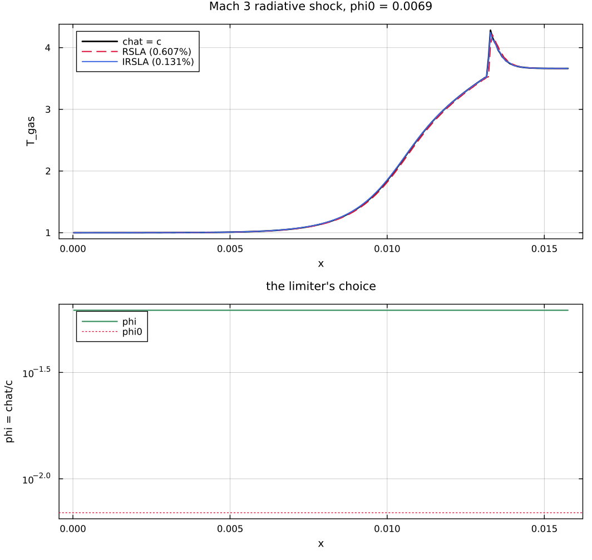

# The variable reduced speed of light: what the measurements say

Findings from implementing the improved reduced speed of light approximation (IRSLA) of Krumholz, Wibking & He in Hydro3D and testing it. The implementation is `src/rsla.jl` plus the two array drivers at the end of `src/radiation_system.jl`; the numbers below are reproduced by `examples/rsla_limiter.jl` and pinned by `test/test_rsla.jl`.

Everything is scored as a relative $L_1$ error in the gas temperature against a $\hat{c} = c$ reference at the same resolution, and — unless a row says otherwise — at the same number of steps as the standard RSLA it is compared with, so every comparison is at equal cost.

## 1. The headline: the improved RSLA removes the $\hat{c}$ dependence of the shock

Lowrie & Edwards Mach 3 radiative shock, $n = 256$, three shock-crossing times.

| $\phi_0$ | RSLA | IRSLA | gain | steps |
|---:|---:|---:|---:|---:|
| 0.0231 | 0.1129% | 0.1321% | 0.85$\times$ | 2726 / 2726 |
| 0.0069 | 0.6066% | 0.1307% | 4.64$\times$ | 2724 / 2726 |
| 0.0023 | 2.5124% | 0.1309% | 19.19$\times$ | 2721 / 2726 |

The interesting column is the third one, and what it shows is stronger than a gain factor: **the IRSLA error does not depend on $\phi_0$ at all**. It is 0.131% at every reduction, while the RSLA error grows by a factor of 22 across the same range. This is what the method is for, and it is a cleaner statement of the result than "19$\times$ better", which only says how far down the RSLA had fallen.

The first row is worth keeping in view. At $\phi_0 = 0.023$ the RSLA is *already* accurate — 0.113% — and the IRSLA is very slightly worse. There is a floor below which the limiter cannot help, set by the rest of the scheme, and above that floor there is nothing to win.

The multigroup Marshak wave of Vaytet et al., $n = 64$, four groups, is the harder case and behaves as the authors report.

| $\phi_0$ | RSLA | IRSLA | gain |
|---:|---:|---:|---:|
| 0.03 | 5.276% | 3.172% | 1.66$\times$ |
| 0.01 | 13.303% | 4.903% | 2.71$\times$ |
| 0.003 | 28.620% | 22.894% | 1.25$\times$ |

Roughly a factor of two, and the $\phi_0$ dependence survives. The authors' own explanation holds: the groups carrying the front's energy sit at $\tau_\mathrm{cell} \lesssim 1$, where the stability bound genuinely caps $\phi$, so no local limiter can make this problem $\hat{c}$-independent.

## 2. The bound is written with the wrong signal speed

This is the finding that matters most, because without it the method does not work at all on the Marshak wave.

The paper's transport-versus-damping channel is derived by balancing the amplification $2\nu_\phi/\sqrt{3} - 1$ of one upwind transport substep against the damping $1/(1 + \nu_\phi \tau_\mathrm{cell})$ of the implicit source substep that follows it, giving

$$\nu_\phi\left(\frac{2}{\sqrt{3}} - \tau_\mathrm{cell}\right) \leq 2 .$$

The $2/\sqrt{3}$ is twice the P1 signal speed $c/\sqrt{3}$. That is correct under the Eddington closure, and correct under M1 wherever the radiation field is isotropic. It is **not** correct wherever M1 free-streams: there the Eddington factor rises to one, the HLL wave speed estimates become $\pm\hat{c}$ rather than $\pm\hat{c}/\sqrt{3}$, and the bound is too generous by exactly $\sqrt{3}$. This is the worst possible place to be too generous, because a free-streaming cell is an optically thin one and has no source damping to fall back on.

The consequence is not subtle. With the published bound, the Vaytet wave is 130% wrong at every $\phi_0$, and the slab — heated by a 1000 K wall — reaches 2158 K.

The mechanism is confirmed independently, with the RSLA switched off entirely so that nothing but the transport step is under test. Running at $\hat{c} = c$, no limiter, and varying only the radiation CFL number $\nu$:

| reconstruction | $\nu = 0.8$ | $\nu = 1.2$ | $\nu = 1.5$ | $\nu = \sqrt{3}$ |
|:---|---:|---:|---:|---:|
| PCM | 2.51% | 2.61% | 32.6% | 79.8% |
| PLM | 0.39% | 0.93% | 139.6% | overflow |
| PPM | 0.05% | 0.65% | 128.7% | overflow |

The scheme dies between $\nu = 1.2$ and $\nu = 1.5$ — for *every* reconstruction, first-order upwind included, so this is not a reconstruction-order effect. It is the closure. $\nu = \sqrt{3}$, which the published bound permits as $\tau_\mathrm{cell} \to 0$, overflows to infinity for PLM and PPM.

The fix is to carry the closure's own signal speed into the bound. Writing $\sigma$ for the fastest signal as a fraction of $c$,

$$\nu_\phi\left(2\sigma - \tau_\mathrm{cell}\right) \leq 2 ,
\qquad
\sigma = \sqrt{\chi\!\left(|\boldsymbol{F}|/cE\right)} ,$$

evaluated per cell through the same `eddington_factor` the Riemann solver uses. It reduces to the published form exactly where the radiation is isotropic, and tightens by $\sqrt{3}$ where it beams. With this in place the Marshak wave goes from 130% to 3.2%, and every number in section 1 above is measured with it.

Two side effects of the correction are worth naming. The cell optical depth beyond which no reduction is needed becomes $\tau_\mathrm{cell} \geq 2\sigma$ rather than $2/\sqrt{3} \approx 1.15$, so it is $2$ in a free-streaming cell and $1.15$ in an isotropic one. And the transparent-cell limit becomes $\phi \leq \phi_0/(\sigma\, C_r)$, which is the ordinary Courant condition at the true signal speed rather than at the P1 one.

## 3. Accuracy is not monotonic in $\phi$ — here, but not in Quokka

**Cross-check, 2026-08-19: this section does not reproduce in Quokka and should not be carried into the paper.** The same scan run on Quokka's Mach 5 supercritical shock is cleanly monotone — $L_1$ errors of 1.29%, 0.50%, 0.23%, 0.12% and 0.068% at $\beta = 0.3, 0.5, 0.7, 0.9, 1.0$, then 172% at $\beta = 1.2$ — so the premise holds there and the stability cliff sits exactly at $\beta = 1$ where the derivation puts it. What follows is a property of this code, or of the Mach 3 problem, and the mechanism proposed below is a conjecture that the Quokka result argues against. It is kept because the difference between the two codes is itself worth understanding.

The paper's argument for taking the largest stable $\phi$ rests on accuracy increasing monotonically with $\phi$. On the shock, in Hydro3D, it does not. Scanning the safety factor $\beta$, which scales both stability channels:

| $\beta$ | shock $L_1$ | Vaytet $L_1$ | Vaytet max $T$ |
|---:|---:|---:|---:|
| 0.3 | 0.1233% | 13.301% | 932 K |
| 0.6 | **0.0590%** | 12.346% | 934 K |
| 0.9 | 0.1307% | 4.903% | 937 K |
| 1.0 | 0.2165% | **3.663%** | 936 K |
| 1.5 | 290.5% | 412.1% | 2947 K |
| 2.0 | 301.5% | 460.3% | 3272 K |

On the Marshak wave accuracy does improve monotonically up to $\beta = 1$, as the argument predicts. On the shock it has a clear minimum at $\beta = 0.6$, and $\beta = 1$ is three and a half times worse than that.

A plausible mechanism is that the HLL flux carries a numerical diffusion proportional to the signal speed, so raising $\phi$ in a transparent cell raises the numerical diffusion there. The accuracy argument counts only the physical error the RSLA introduces and does not see this. If that is right, the optimal $\phi$ is a balance between two errors rather than the stability bound itself, and the balance point is problem-dependent — which would make $\beta$ a real tuning parameter rather than a safety margin, and would weaken the "no tunable physics parameters" claim.

The cliff between $\beta = 1$ and $\beta = 1.5$ is sharp and is where the derivation says it should be: $\beta = 1$ sits exactly on the derived bound. That part of the theory is confirmed. Note also that $\beta \geq 1.5$ on the shock costs 9$\times$ the steps as well as being wrong, so it fails loudly there; on the Marshak wave it runs to completion at the same cost and is silently 412% wrong, which is the failure mode the stability-bound formulation exists to exclude.

## 4. A per-group $\phi$ costs an accounting identity

The paper gives each group its own $\phi$, "which poses no difficulty because the groups form independent hyperbolic subsystems coupled only through the common matter state". The groups are independent in transport. They are not independent in the coupling. Summing the source terms,

$$\frac{d}{dt}\left[e + \sum_g E_g\right] = c\,\rho \sum_g \left(\phi_g - 1\right)\left(\kappa_P B_g - \kappa_E E_g\right) .$$

With $\phi$ uniform the sum collapses onto the gas equation and leaves the exact identity

$$\Delta\left[e + \sum_g E_g\right] = \left(1 - \phi\right) \Delta e .$$

Nobody claims the RSLA conserves energy. What this says is stronger and is worth stating: the RSLA's non-conservation is *determined by how much energy the gas gained or lost, and by nothing else*. It does not depend on the spectrum, on how many absorption and re-emission cycles the run performed, or on which groups they passed through.

With $\phi$ varying between groups the sum does not collapse and the identity fails. Measured in a single cell with no transport at all, relaxing over 400 coupling steps: the identity holds to five decimals at $\phi = 0.1$ and at $\phi = 0.01$; at $\phi = (1, 0.1)$ it predicts no drift whatever — the gas equation is unmodified and $\phi_1 = 1$ — and the measured drift is $-44.5\%$ of the cell's initial energy. At $\phi = (1, 0.01)$ it is $-56.7\%$. Exchanging which group is the fast one changes the answer again. What replaces the identity is an error set by the path energy took through the spectrum, and that is not a quantity anyone can account for.

Whether it *hurts* is a separate question, and on the Vaytet wave it does not:

| $\phi_0$ | one $\phi$ per cell | one $\phi$ per group |
|---:|---:|---:|
| 0.03 | 3.172% | 3.975% |
| 0.01 | 4.903% | 2.830% |
| 0.003 | 22.894% | 18.579% |

Per-group is better at two of the three reductions. So this is a latent hazard rather than an observed failure, and the choice is a judgement call. Hydro3D defaults to one $\phi$ per cell — taken from the most restrictive group, which is the largest value every group is simultaneously stable at — on the grounds that a conservation property one can write down is worth a few per cent of $L_1$ error. `StabilityBound(per_group = true)` reproduces the published prescription.

## 5. The advantage grows under refinement

The open question in the project's handoff notes is what happens as the grid is refined, since $\tau_\mathrm{cell} \propto \Delta x$ moves cells from the thick side of the bound to the thin side and leaves the limiter less room. The expectation is that the advantage shrinks. On the shock it does the opposite.

| $n$ | RSLA | IRSLA | gain |
|---:|---:|---:|---:|
| 64 | 0.6491% | 0.2164% | 3.00$\times$ |
| 128 | 0.5379% | 0.1755% | 3.07$\times$ |
| 256 | 0.6066% | 0.1307% | 4.64$\times$ |
| 512 | 0.6742% | 0.0624% | 10.81$\times$ |

The IRSLA error falls by a factor of 3.5 from $n = 64$ to $n = 512$ while the RSLA error is flat, or slightly rising. That is the more important statement: **the IRSLA converges under refinement and the RSLA does not.** The RSLA's error is a modelling error, not a discretisation error, so refining the grid cannot remove it; the IRSLA reduces it to something that refines away. The gain factor grows because the denominator shrinks, not because the numerator grows.

## 6. What happened when these were checked against Quokka

All of section 2 and section 4 were confirmed by reading Quokka's `ComputeReducedSpeedOfLightFactor` and its multigroup source term, and the section 2 correction was implemented and measured there. Quokka is now at `0bf3741b` on `chong/iRSLA-framework-202607-improved`, with `radiation.variable_chat_legacy` restoring the published behaviour bit by bit.

Confirmed and fixed in Quokka:

| | effect on Quokka's own tests |
|:---|:---|
| the $P_1$ signal speed in the bound (§2) | supercritical shock 0.159% $\to$ 0.116%; Vaytet at $\phi_0 = 0.01$, 8.30% $\to$ 3.65% |
| the bound evaluated at the nominal rather than the actual CFL number (§6, third point) | Vaytet 3.65% $\to$ 1.97% with $\sigma$ also corrected; **57%** with $\sigma$ left alone |
| $\beta$ multiplying an absent bound, capping $\phi$ at 0.9 in thick cells | no measurable effect; makes the paper's conservation claim true |
| the interface reading a cell the face does not touch (new, found in Quokka) | $\leq 0.2\%$ on the Vaytet wave, zero on the shock |

The third row is the important one. Quokka's Vaytet runs stepped at $C_r = 0.4$ while evaluating the bound at $0.3$, so every $\phi$ exceeded the derivation by a third. Correcting that alone — unambiguously the right thing to do in isolation — takes the error from 8.3% to 57% and drives the slab to 1118 K under a 1000 K wall. The two errors were partly cancelling, which is why the published campaign looked healthy, and why they have to be fixed together.

Found and confirmed, but **not** acted on in Quokka: the per-group $\phi$ of section 4. The identity fails there exactly as it does here — Quokka's multigroup source term carries `cscale[g] = 1/phi_g` — but per-group is *slightly more accurate* on the Vaytet wave, so it stays a decision rather than a bug.

Not reproduced: the non-monotonicity of section 3, as noted above.

## 7. Smaller points

**The paper contradicts itself on the interface value.** Section 5's transport paragraph defines $\phi_{i+1/2} = \min(\phi_i, \phi_{i+1})$ and argues for it at length — an optically thick cell must not impose a CFL-violating signal speed on a transparent neighbour that has no source damping to control the amplification. The algorithm summary at the end of the same section says $\hat{c}_{i+1/2} = \max(\phi_i, \phi_{i+1})c$. The argument is right and the summary is a typo. Hydro3D implements the minimum, and `test/test_rsla.jl` asserts it.

**The radiation-force step constraint should not be evaluated when the gas cannot move.** Equation (33)'s constraint comes from a feedback loop that runs through the gas velocity: an amplified flux perturbation accelerates the gas, and the gas re-seeds the radiation field on the next step. With hydrodynamics disabled the loop is open. On the Vaytet wave — a static problem with hot radiation over cold gas, so $2\mathcal{P} > \phi_0$ over much of the slab — applying it anyway cost 5.4$\times$ the steps for no change in the answer at all.

**Evaluate the bound at the step actually being taken.** The paper writes the bound in terms of the code's nominal radiation CFL number $C_r$, on the assumption that $\Delta t = C_r \Delta x/(\phi_0 c)$. When the step is shorter than that — because hydrodynamics limited it, or because subcycling divided it unevenly — the nominal form understates how much $\phi$ is available. Hydro3D forms $\nu_0 = \phi_0 c \Delta t \sum_d 1/\Delta x_d$ from the actual step, which reduces to $C_r$ whenever the radiation CFL is what binds and is never less conservative than the nominal form.

## 8. What would be worth doing next

The non-monotonicity in section 3 is the loose end that matters. If the mechanism really is the HLL numerical diffusion, then the accuracy argument that justifies "take the largest stable $\phi$" needs a second term, and the right local $\phi$ is where the two errors balance. That balance is computable: the RSLA error scales as $(1-\phi)$ times something the coupling already knows, and the HLL diffusion scales as $\phi\, c\, \Delta x$ times a gradient the transport step already forms. A limiter built on the balance rather than on the bound alone would be a genuinely different rule, and section 3's table says there is roughly a factor of two in it on the shock.

Two smaller ones. The energy-exchange channel is missing from the damping estimate — the paper notes that the true stability boundary reaches $\phi = 1$ at $\tau_\mathrm{cell} \approx 0.8$ rather than the $2\sigma$ the closed form gives, because energy exchange damps beyond the flux-relaxation channel the derivation counts. Recovering that would widen the useful range of the limiter by about 40% in the transition region, which is exactly the region the Marshak wave lives in. And $\sigma$ is currently evaluated from the state at the start of the stage; in a cell whose radiation field is beaming up rapidly, the state at the end is what the step has to survive.
